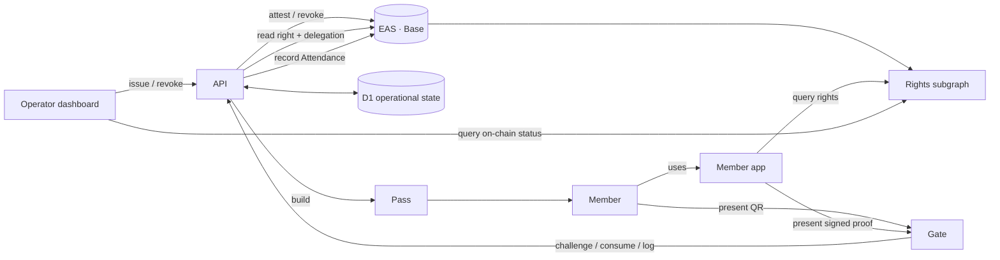

# Architecture

fuda treats membership and access as on-chain rights. The API coordinates issuance and operational state, while EAS on Base remains the authority for a right's contents, issuer delegation, and revocation. Passes and apps present or control those rights; they do not replace the chain as the source of validity.

## Components

| Component | Path | Responsibility |
| --- | --- | --- |
| API | `apps/api` | Coordinates issuance, revocation, gate operational state, and pass generation. Void discovers its server routes and runs shared request middleware ([API routing](#api-routing)) |
| Operator dashboard | `apps/dash` | Gives authorized issuers routed Overview, Rights, and Issue views; derives operational summaries from D1 member rows, issues and revokes through the API, and queries chain status separately through the rights subgraph. Its Void Worker renders the pages, holds the session in HttpOnly cookies and forwards the browser's api calls ([Frontend Workers](#frontend-workers)) |
| Member app | `apps/app` | Holds member signing rails, answers Signed challenges, lists public member passes from holder addresses and device memory |
| Gate | `apps/gate` | A directly mounted Preact SPA that reads presented rights and renders an ADMIT or REJECT verdict through its Worker |
| EAS on Base | External; `apps/api` | Records Entitlements, issuer delegation, revocation, and Attendance evidence |
| D1 (SQLite) | `apps/api/migrations` | Stores operational state such as challenges, SINGLE_USE consumption, entry logs, and member indexes |
| Passes | `packages/pass` | Builds the Google Wallet save link and the Apple `.pkpass`; the api renders the browser-based pass. Passes present a right and are never its source of truth |
| Rights subgraph | `packages/subgraphs/rights` | Indexes EAS directly for right cards and dashboard on-chain-status queries |

## Browser query state

`@fuda/libs` exposes shared library integrations through separate subpaths, with no root barrel. Browser and backend integrations may coexist, provided that runtime-specific dependencies stay behind their own entry points.

Gate mounts from `index.html` without a pages router. Its hardware-reader listener is installed before paint. All three frontends render with Preact and share `@fuda/ui`. Dash and app use the pinned `void-preact` pages adapter. Both Scanner consumers use the same renderer-independent camera lifetime and labels. The renderer decision is recorded in [Preact frontends](#preact-frontends).

Dash keeps three lifetimes outside its components. The card draft is module state behind a subscription hook (`useSyncExternalStore`), so it survives a route change inside the browser and is dropped by a full navigation; a server render never reads or writes it. The layout compares the cookie session it first rendered with against the shared session on every refresh, and on a difference renders nothing and reloads instead of letting an old form write under the new session. Ceremonies, requests and timers that outlive a render keep their generation and in-flight guard in refs and are dropped on unmount.

The member app's public pass list uses `@fuda/libs/query` over TanStack Query Core. Each query hook keeps one observer across renders and reads optimistic results for the current key through an external-store subscription. A local scope mounts one independent client and clears and unmounts it on disposal. Member-route navigation shares a browser-document client; sign-out leaves that document and drops the cache. Server renders never use a shared client. Reads become stale after 30 seconds and refresh on focus or reconnect; the public pass list also refreshes every 30 seconds while visible. Transient read failures retry once, HTTP 4xx failures do not, and writes have no automatic retry.

Public list keys identify API and graph deployments, holder addresses, and remembered public passes. Dashboard keys identify the API deployment and a session generation. Tokens remain in request closures, and session replacement clears protected cache entries. Restoring a saved token always requires a fresh server validation. Successful issuer mutations reconcile or invalidate cached reads, cancelling older reads so they cannot undo the update.

This cache supports presentation, not authorization or admission decisions. It is not persisted, and it never holds signing keys. Domain filtering, signing, and API write workflows remain in the applications.

## Authority and trust boundaries

- **Right validity is on-chain.** The API reads the Entitlement and its IssuerDelegation from EAS on the scanner’s behalf. The hosted scanner trusts the API verdict; an independent verifier can read those records directly.
- **Admission also has operational state.** D1 tracks one-time challenges, SINGLE_USE consumption, and entry logs. Failure to read required chain or delegation state fails closed.
- **Passes are presentation surfaces.** Revoking an Entitlement changes the next gate verdict without replacing its Apple, Google, web, or QR pass.
- **The rights subgraph reads EAS directly.** It is the only indexer on a product read path; the Substreams packages are archived. Browser queries fail explicitly when no public endpoint is configured, and do not fall back to the API or D1. The subgraph is not advertised as a Graph composition source, because its `Right` and `Delegation` entities change when revocations arrive.
- **Admin routes fail closed.** Issue, revoke and member listing require `ADMIN_TOKEN` wherever a signer or `BASE_RPC_URL` is configured; a deployment with either binding and no token locks them rather than opening them.
- **A connected app reaches one Issuer.** Its access token names the Issuer chosen at approval and the routes it reaches read only that Issuer; it cannot create an Issuer or act as the Operator. Only the account that registered the app can approve it.
- **The public verify endpoints are unauthenticated by design.** `GET /v1/verify/:uid` and `POST /v1/verify` take a uid that is public on chain, so anyone who learns one can preview it. `GET /v1/verify/:uid` is a read-only preview and never consumes a slot; a bare `POST /verify` is an admission, so it burns a SINGLE_USE right's slot. What that buys an attacker, and why Signed is the answer for rights that must resist it, is in the attestation model's [threat model of the public verify endpoints](./specs/attestation-model.md#api-payloads-that-touch-attestations).

## UX and decentralization

fuda's core is decentralized and ownable: a right is an on-chain attestation that anyone can verify and the member can come to own. For UX, fuda surfaces that core through Apple, Google, and its own hosted backend. The design principle: **decentralized at the core, on rails only for UX.** The core carries the guarantees and a right's validity never leaves it; the rails add convenience on top. Strip a rail away and every function keeps working — with somewhat worse UX — because the fallback is the core itself.

| Function | Best UX (platform / fuda-hosted) | Decentralized fallback (self-runnable) | What survives without fuda or the platform |
| --- | --- | --- | --- |
| Right validity | — (never on a rail) | the on-chain EAS attestation itself | everything — this is the substrate |
| Pass presentation | Apple Wallet / Google Wallet | browser-based pass; ultimately the QR and holder address | the right is untouched; only the presentation surface degrades |
| Gate verification | fuda gate app + API | anyone reads the Entitlement and delegation from EAS via `eth_call` | permissionless verification; no fuda account needed |
| Issuance | fuda API with the backend included | the issuer attests directly with its own key; IssuerDelegation is an on-chain record | proof of issuing authority stays on-chain |
| Signing keys | passkey with OS sync | bring-your-own EOA or compatible smart wallet | open signature rails: ECDSA, ERC-1271, ERC-6492 |
| Sign-up (first mile) | self-serve card mint to a fuda-owned smart account | direct Signed issuance to a member wallet | issuance still works; the instant, frictionless path is fuda's added value |
| Restore | pass re-download, saved link or backup file | reissue by the issuer under a new uid | points and history persist on-chain at the stable holder |

In most rows the UX layer only carries presentation, delivery, or assistance, and validity never leaves the chain. In the signing-key rows the UX layer holds authority: a Standard right sits at a fuda-owned account, and the exit is to be issued a Signed right directly to the member's own wallet.

## Models

- [Attestation model](./specs/attestation-model.md) — Entitlement, IssuerDelegation, Attendance, lifecycle, and the EAS/D1 authority boundary
- [Pass types and flows](./specs/pass-types-and-flows.md) — use-case templates, wallet roles, standard issuance, the gate protocol, the pass contracts, and the deployed surfaces
- [ENS naming](./specs/ens-naming.md) — ENS hierarchy, the member number, what a name resolves to, name lifecycle

## Environments

fuda runs one deployment per chain, and they never share state. Each owns its own D1 database, its own R2 bucket, its own Worker secrets and its own EAS schema and delegation UIDs, because a schema UID is per chain and an attestation on one chain means nothing on another.

|  | Chain | D1 | R2 | Hostnames | Branch |
| --- | --- | --- | --- | --- | --- |
| local | in-memory fake (`USE_FAKE_CHAIN`) | the local simulated database | simulated; `fuda-media-local` only for remote-binding runs | none | any |
| develop | Base Sepolia | `fuda-beta` | `fuda-media-dev` | `*.fuda.sh` today, `*.dev.fuda.sh` after the mainnet cutover | `develop` |
| production | Base mainnet | `fuda` | `fuda-media` | `*.fuda.sh` from the cutover | `main` |

The Sepolia deployment is live on the apex hostnames today and keeps them until the cutover; the `production` target therefore carries no `routes`, so deploying it early cannot take a hostname from the running one. The local environment is named `local`, not `dev`, so it is never confused with the deployed develop one. Each environment is a target of the api in `apps/api/targets.jsonc`, deployed as its own Void project ([Void deployment](#void-deployment)). Nothing is migrated at the cutover, so production begins with an empty database and bucket and every member re-claims their card: carried-over rows would point at attestations the mainnet gate cannot read. Separate storage also means a wrong-target deploy cannot touch a production venue. D1 databases and R2 buckets cannot be renamed, so their names were chosen once.

Because each frontend's Worker uses `https://api.fuda.sh` unless its optional `API_BASE_URL` var overrides it, a deployment belongs to exactly one environment: a develop deployment must point at the develop api. The deploy order and the one-time chain setup per environment are in the [runbook](./runbook.md).

## Configuration

The deployment's configured values, and what fails when one is missing, are tabulated once in the attestation model's [chain fixtures](./specs/attestation-model.md#chain-fixtures) and [configured values](./specs/attestation-model.md#configured-values). In outline:

- **`apps/api/targets.jsonc` `vars`**, one set per target — the chain addresses and the api's own base: `EAS_ADDRESS`, `EAS_SCHEMAS`, `ISSUER_ADDRESS`, `DELEGATION_UID`, `GRAPH_START_BLOCK` (the rights-subgraph manifest's generated start block; it is not read by the API), `FACTORY_ADDRESS` (the smart-wallet factory the Bearer holder address is derived from), and `API_BASE_URL` (the absolute base of the `passUrls` in an `/issue` response, and the api entry in the Google Wallet `origins` claim).
- **Worker secrets** — `SIGNER_PRIVATE_KEY`, `ADMIN_TOKEN`, `BASE_RPC_URL`, the four `GOOGLE_*` names and the five `APPLE_*` names. A wallet platform is all-or-nothing: a missing name answers `501`, never a broken pass.
- **`USE_FAKE_CHAIN`** — local development only (`apps/api/targets/local/.env`); it swaps in an in-memory chain and is never set in a deployed environment.
- **Frontend environment** — each Worker's optional `API_BASE_URL` var, emitted by `void.config.ts` only when explicitly set in the shell (otherwise the Worker defaults to `https://api.fuda.sh`); `VITE_GRAPH_RIGHTS_ENDPOINT` in the member app and dashboard; `VITE_ENS_PAYMASTER_URL` in the dashboard; `VITE_APP_ORIGIN` and `VITE_RP_ID` in the member app. Vite bakes the `VITE_*` values in at build time, so changing one means redeploying that app.

## Member app responsibility

`apps/app` serves two journeys from one Worker and origin. Public `/@handle/*` venue pages own their navigation and issuance flow without a member session. The public member top and `/signin` lead to server-verified passkey login; `/rights`, `/signed`, and `/settings` share a session and Dock. Member and operator credentials have separate server audiences and HttpOnly cookies; neither is authority for the other's endpoints. The shared `@fuda/libs/wallet` and `@fuda/libs/auth` modules own wallet validation, the challenge/signature sequence and passkey ceremonies. Product controllers own restoration, navigation and domain data. `@fuda/ui` shares the native confirmation dialog, appearance controls and preference lifecycle. The opened Sensitive member secret stays in component state until that screen unmounts. Vault and WebAuthn operations begin in user events, and late completions cannot reopen an unmounted screen.

`apps/app` is also the member-owned public pass surface. Its `/rights` list unions public Graph rights for the authenticated Holder or a manually entered public address with pass UIDs remembered by that browser, then treats `GET /v1/verify/:uid` as the live source for each row's status and entitlement metadata. It can display degraded device-only rows when the public index is unavailable. A signed-in account also keeps its pass list on the server through `/v1/member/passes` ([Member pass list and recovery](./specs/pass-types-and-flows.md#member-sign-in)).

The strings a client and the api must agree on byte-for-byte — the QR payload, the challenge string, the nonce shape and the passkey `rp.id` — are pinned in the attestation model's [wire constants](./specs/attestation-model.md#wire-constants). Changing any of them is a protocol version bump.

## Platform

### Void deployment

Decided 2026-10-31. Every app builds and deploys with Void.

- **Each API target is its own Void project** under `apps/api/targets/<name>/`, because Void has no named environments. `apps/api/targets.jsonc` holds every target's configuration, in JSONC because the rights subgraph reads it as an independent package.
- **Migrations stay hand-written SQL**, shared into each target by symlink. Schema inference stays off, so Void generates no migrations.
- **Secrets stay Worker secrets**, managed with `void secret`.
- **Void and its adapter upgrade together**, under the three-day `minimumReleaseAge` with exact-version exemptions.
- **The browser suite is the safety net.** It asserts on roles and visible text only, so a framework change does not touch it.

### Frontend Workers

Decided 2026-10-31. `dash` and `app` are Void pages apps; `gate` is a single-page app with the same Worker.

- **Each frontend Worker is the browser's only backend.** The browser never holds an API token. The Worker keeps the session in an HttpOnly, `SameSite=Lax` cookie and calls the API with `Authorization: Bearer`.
- **Loaders read and a forwarding route writes.** `/api/*` adds the Bearer header, clears the cookie on an API 401, and refuses a write whose `Origin` is another site. `/session/*` routes set or clear the cookie; they are plain routes because the browser needs their result as data before it navigates.
- **The API still sees the visitor's IP.** On a same-zone subrequest Cloudflare takes `CF-Connecting-IP` from `x-real-ip`, so each Worker sets it to its own visitor's address.
- **Sign-in still happens in the browser**, in a page that is not server-rendered, which then posts the signature to the Worker.
- **The dashboard admin token is typed in and kept in an HttpOnly session cookie.** The Worker never holds `ADMIN_TOKEN` as a secret.
- **Gate is not a pages app.** A hardware reader types a scan as soon as the page is open, and a pages app mounts only after the router has loaded the page component.
- **Route guards live in Worker middleware**, and theme and language live in cookies so the first response is right.
- **The API origin stays server-side**, as `API_BASE_URL`. Browser-visible values stay `VITE_*` build values.
- **`/@<handle>` is rewritten in middleware**, because a file route cannot start with `@` and a static rewrite would catch Vite's `/@id/` URLs.

Nothing calls the API from a browser except its own pages and the wallet's paymaster requests, so the API answers no CORS for fuda's hosts.

### API routing

Decided 2026-11-01. Void discovers `routes/` files, which re-export `defineHandler` values from `src/handlers/`. No code mounts Hono sub-apps by hand.

- **Target projects link the same route tree**, so adding an endpoint changes one file.
- **Ordered middleware supplies request dependencies**, then CORS, auth-mode headers and cache policy.
- **Programmatic routes stay under `/v1`.** Pass, asset, ENS gateway and health routes stay unversioned, because deployed wallets and contracts keep those URLs.
- **Workerd tests register the same route files** in a test-only adapter, so chain, time and admission stay injectable. Production discovery is verified by the Void build and the browser suite.

Hono remains a direct dependency for middleware, response helpers and server-rendered pages, with its version aligned across the workspace and Void.

### Preact frontends

Decided 2026-11-05. All three frontends use Preact through `void-preact`, with plain hooks and no signals.

The owner chose it to dogfood their own adapter. This is a preference, not a measured advantage. The adapter's README advises against production use, and the owner accepts that risk.

- **Exact pins**: `void-preact@0.1.3`, `void@1.7.0`, `preact@11.1.1`, `preact-render-to-string@6.8.2`. A Void upgrade waits for an adapter release that supports the new version.
- **Preact reruns component bodies.** Refs hold component lifetimes, request generations and busy guards. Pages get stable callbacks, because a function prop in an effect dependency list reruns the effect whenever the parent hands over a new function.
- **Gate installs its reader listener with layout-effect timing**, and keeps the camera's late-stream cleanup and the duplicate-scan guard.
- **`@fuda/ui/wallet-button` stays a Hono HTML helper**, because the API renders it on the server.

Compared with the previous renderer, the member app's client JavaScript is 11,373 gzipped bytes smaller, and the dashboard and gate are within 12 bytes. A real authenticator, wallet sign-in, live ENS claim, camera and hardware reader remain owner checks, and Safari and Firefox are unverified.

## Related documentation

- [Runbook](./runbook.md) — one-time chain setup, secrets and vars, deploy order, smoke ladders, reconciliation
- [api README](../apps/api/README.md) — running the api locally, endpoints, error codes
- [Glossary](./CONTEXT.md)
