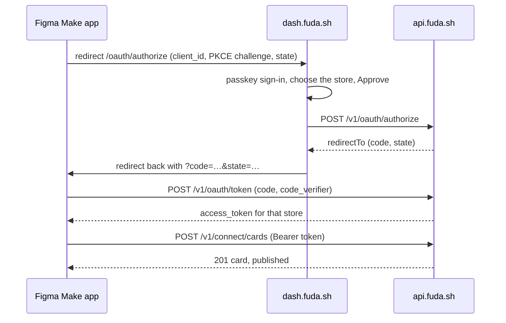

# Figma Make apps in fuda

A store can build its own small app in Figma Make — a sign-up page, a campaign page, a tool for the counter — and have it create the store's cards in fuda. The app runs only in the browser and holds no secret: the operator approves it once in fuda, and it receives an access token for that one store. Cards created this way are published at once, and the store does not need to claim its ENS name first. The contract is in [Connected apps](../specs/connected-apps.md).



## Set up

1. Sign in to `dash.fuda.sh` with your passkey and create your profile if you have none. Apps cannot create a profile.
2. Publish the Figma Make app once so it has its address, for example `https://your-app.figma.site/`.
3. In the dashboard, open **Apps**, register the app with that address as its return address, and copy the client ID. Register the editor-preview address as well if you want to test inside Figma's preview; fuda only answers pages at a registered address.
4. Put the client ID into the app (below). It is not a secret.

Only the account that registered the app can approve it. An account with several profiles chooses one on the consent page; approving the app for a second profile is a separate approval with its own token, and neither token reaches the other profile's cards. The dashboard's Apps page lists every live approval and can revoke it, or delete the app with all of its approvals.

## The client

The kit's `make-setup-app` (Vite + TypeScript) needs one file. Save this as `src/fuda.ts`:

```ts
// fuda connected-app client for a browser-only app (Figma Make).
// Approval: full-page redirect with PKCE. No client secret exists or is needed.
const FUDA_API = 'https://api.fuda.sh/v1'
const FUDA_AUTHORIZE = 'https://dash.fuda.sh/oauth/authorize'
const CLIENT_ID = 'app_...' // from the fuda dashboard, Apps page
const REDIRECT_URI = `${location.origin}/` // must be registered exactly as written

export const config = {
  api: FUDA_API,
  authorize: FUDA_AUTHORIZE,
  clientId: CLIENT_ID,
  redirectUri: REDIRECT_URI,
}

const base64Url = (bytes: Uint8Array): string =>
  btoa(String.fromCharCode(...bytes))
    .replace(/\+/g, '-')
    .replace(/\//g, '_')
    .replace(/=+$/, '')

const randomString = (): string => base64Url(crypto.getRandomValues(new Uint8Array(32)))

// 1. Send the browser to fuda. The operator signs in, picks a profile and approves.
export const connectFuda = async (): Promise<void> => {
  const verifier = randomString()
  const state = randomString()
  const digest = new Uint8Array(await crypto.subtle.digest('SHA-256', new TextEncoder().encode(verifier)))
  sessionStorage.setItem('fuda.verifier', verifier)
  sessionStorage.setItem('fuda.state', state)
  const url = new URL(config.authorize)
  url.search = new URLSearchParams({
    client_id: config.clientId,
    code_challenge: base64Url(digest),
    code_challenge_method: 'S256',
    redirect_uri: config.redirectUri,
    response_type: 'code',
    scope: 'cards:read cards:write',
    state,
  }).toString()
  location.assign(url)
}

// 2. Back on the redirect URI: trade the code for an access token.
export const finishFudaConnect = async (): Promise<string | null> => {
  const params = new URLSearchParams(location.search)
  const code = params.get('code')
  if (code === null) {
    return sessionStorage.getItem('fuda.token')
  }
  const verifier = sessionStorage.getItem('fuda.verifier')
  if (params.get('state') !== sessionStorage.getItem('fuda.state') || verifier === null) {
    throw new Error('state mismatch: start again')
  }
  history.replaceState(null, '', location.pathname) // drop ?code= from the address bar
  const res = await fetch(`${config.api}/oauth/token`, {
    body: new URLSearchParams({
      client_id: config.clientId,
      code,
      code_verifier: verifier,
      grant_type: 'authorization_code',
      redirect_uri: config.redirectUri,
    }),
    method: 'POST',
  })
  const body = await res.json()
  if (!res.ok) {
    throw new Error(body.error)
  }
  sessionStorage.removeItem('fuda.verifier')
  sessionStorage.setItem('fuda.token', body.access_token)
  return body.access_token
}

const call = async (token: string, path: string, init: RequestInit = {}) => {
  const res = await fetch(`${config.api}${path}`, {
    ...init,
    headers: { authorization: `Bearer ${token}`, 'content-type': 'application/json' },
  })
  const body = await res.json()
  if (!res.ok) {
    throw new Error(body.error)
  }
  return body
}

// 3. Act for the approved profile.
export const createCard = (token: string, card: { slug: string; title: string; description?: string }) =>
  call(token, '/connect/cards', { body: JSON.stringify({ category: 'membership', ...card }), method: 'POST' })
export const getCard = (token: string, cardId: string) => call(token, `/connect/cards/${cardId}`)
export const listCards = (token: string) => call(token, '/connect/cards')
```

And call it from `src/main.ts`:

```ts
import { connectFuda, createCard, finishFudaConnect, getCard } from './fuda.ts'

const app = document.querySelector<HTMLDivElement>('#app')!
const token = await finishFudaConnect()

if (token === null) {
  app.innerHTML = '<button id="connect">Connect fuda</button>'
  document.querySelector('#connect')!.addEventListener('click', () => void connectFuda())
} else {
  const created = await createCard(token, { slug: 'spring-2026', title: 'Spring members' })
  const { card, url } = await getCard(token, created.card.id)
  app.innerHTML = `<p>${card.title} is live at <a href="${url}">${url}</a></p>`
}
```

`finishFudaConnect` checks `state` against the value saved before the redirect and trades the code for a token with the PKCE verifier; the token lives in `sessionStorage`, so it ends with the tab. A token lasts 30 days. When a call answers `401`, send the operator through `connectFuda()` again.

## What the app can do

| Call | Scope | Result |
| --- | --- | --- |
| `GET /v1/connect/issuer` | any | the approved store, its public page and the token's scopes |
| `GET /v1/connect/cards` | `cards:read` | the store's cards |
| `POST /v1/connect/cards` | `cards:write` | a new card, published when the call returns |
| `GET /v1/connect/cards/:cardId` | `cards:read` | one card and its public page |
| `POST /v1/oauth/revoke` | — | ends the app's own token (`token`, `client_id`) |

A card body is the dashboard's: `category` (`membership` or `ticket`), `slug` (lowercase letters, digits and `-`, unique within the store), `title`, and optionally `description`, `claimFrom`/`claimUntil`, `validityDays` or `validFrom`/`validUntil` (unix seconds), `lockScreen` and `venue` `{ lat, lng }`. A taken slug answers `409 slug_taken`; a malformed one `400 bad_slug`.

## When something is refused

| Answer | Meaning |
| --- | --- |
| consent page: "not registered" / "return address" | the client ID or `redirect_uri` does not match the Apps page exactly |
| consent page: "Only the account that registered this app" | another account is signed in to fuda |
| `401 invalid_client` from `/oauth/token` | the page's origin is not one of the app's return addresses |
| `400 invalid_grant` | the code was used, expired (10 minutes), or the verifier or `redirect_uri` differs |
| `401 unauthorized` from `/connect/*` | the token was revoked, expired, or is used from another site |
| `403 insufficient_scope` | the app was approved without `cards:write` |

## Try it locally

With the api on the fake chain (`pnpm dev:dash+api`, see the [runbook](../runbook.md#12-local-development)), point the client at it:

```ts
config.api = 'http://localhost:8787/v1'
config.authorize = 'http://127.0.0.1:5175/oauth/authorize'
```

Register `http://localhost:<port>/` — the port the kit's `vite` serves on — as the return address, and sign in on `127.0.0.1:5175` with a passkey.
