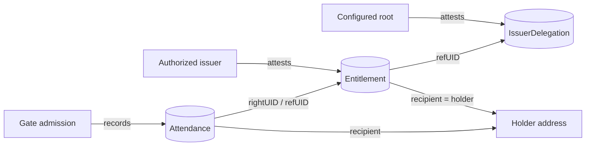

# Attestation model

fuda represents authorization as a small graph of EAS attestations on Base. This document defines the durable records, references, and authority boundary, and records the exact schema strings, configured values, payload shapes, D1 tables, and tests that the MVP implementation binds to (see [MVP implementation reference](#mvp-implementation-reference)).

## Records and roles

### Records

| Record | Responsibility |
| --- | --- |
| `Entitlement` | The revocable right held by a wallet address, including its issuer, usage policy, tier, validity window, serial value, and metadata reference |
| `IssuerDelegation` | The root-authorized statement that identifies an issuer allowed to create trusted Entitlements |
| `Attendance` | Evidence that a gate admitted the holder of an Entitlement, referencing that right and recording the entry context |
| Offchain pass | A right signed as an EAS offchain attestation and stored in D1, with no holder address and no per-pass transaction. See [Offchain rights](#offchain-rights) |

### Roles

| Role | Responsibility |
| --- | --- |
| Configured root | Establishes the trust root by attesting IssuerDelegation records |
| Issuer | Attests and revokes Entitlements under a valid delegation |
| Operator | Uses the dashboard and API to exercise the issuer authority available to their account |
| Holder | Receives or controls the address named by an Entitlement |
| Gate | Reads EAS, applies the verification policy, coordinates operational admission state, and returns ADMIT or REJECT |



## Entitlement lifecycle

1. **Delegate.** The configured root attests an IssuerDelegation for an issuer. This creates the trust path the gate will later validate.
2. **Issue.** An authorized issuer attests an Entitlement whose recipient is its holder and whose `refUID` points to the governing IssuerDelegation. The public MVP waits for confirmed chain state before returning the issued UID.
3. **Verify.** The gate reads the Entitlement and delegation from EAS. It checks accepted schemas, delegation authority, revocation, validity bounds, and the usage model. Signed policies additionally verify a fresh challenge against the holder.
4. **Admit.** Admission consumes any required operational slot and creates an entry log. For an on-chain right whose `level` is `0` or `1` the API then attempts to attest Attendance without delaying the gate verdict, **when its Card has Attendance on**. A Card's `attendance` is set per Card (see [pass types and flows](./pass-types-and-flows.md)): it defaults on for a ticket and off for a membership, and only an on-chain Card has it, because an offchain right has no holder and keeps its visits in D1. The API reads the Card once per on-chain admission, so an edit applies to the next scan; a right issued under no Card (the admin `POST /issue`) records unless it is `level == 2`, and a Card that cannot be read records nothing. A public record of a visit is permanent, which is why a membership does not write one unless the operator turns it on; an Attendance write failure may leave the successful entry represented only in operational logs. **No Attendance is attested for a `level == 2` (+Private) right**: the stealth holder is unlinkable to the member, but a public Attendance would still publish that right's visit history, which is exactly what +Private exists to hide. Its entries live only in the entry log.
5. **Revoke.** The issuer revokes the Entitlement on EAS. A later gate read rejects the same pass because the on-chain right is no longer valid.

Holder-preserving activation is designed to change the owners of a claimable smart account, not the Entitlement, leaving its holder address, attestation UID, Attendance history, and other public history unchanged. It is not implemented.

## Identity and reference invariants

- An Entitlement's EAS recipient is its holder address.
- An Entitlement's `refUID` identifies the IssuerDelegation that governs its issuer. The gate checks that delegation's schema, root attester, active flag, revocation state, and delegated issuer.
- Attendance identifies the admitted Entitlement through `rightUID`; its EAS reference also points back to that right.
- EAS recipients are immutable. Moving a right to a different holder requires a fresh attestation rather than editing the existing record.
- Activating a claimable smart account (not implemented) would not move the right, because account ownership changes behind the same holder address.
- Crossing the +Private boundary requires a fresh holder and attestation. The transition must not publish an on-chain lineage link that correlates the private and non-private rights.

The [pass types and flows](./pass-types-and-flows.md) guide explains when the holder is a claimable smart account, direct wallet, or one-time stealth address.

## On-chain authority and D1(SQLite) operational state

| EAS / Base — authoritative chain facts | D1(SQLite) — operational and indexed state |
| --- | --- |
| Attestation UID, schema, data, attester, recipient, and reference | Member index and product-facing status |
| IssuerDelegation authority and revocation | One-time Signed challenges and consumption timestamps |
| Entitlement contents and revocation | SINGLE_USE slot consumption |
| Confirmed Attendance evidence | Gate entry logs and optional Attendance UID backfill |
| ERC-5564 announcement events | — (queried from the rights subgraph) |

D1 can make the product responsive and enforce admission state that EAS does not model, but it cannot make an invalid or revoked Entitlement valid. If the gate cannot read required chain or delegation state, it must **fail closed** instead of trusting a cached D1 copy.

The split also means the two stores need not advance atomically. A confirmed Entitlement can exist before an index update, and a successful entry log can exist when its asynchronous Attendance attestation failed. Consumers must distinguish authoritative chain evidence from operational observations.

## Schema evolution and consistency

EAS schemas are immutable. fuda therefore treats each record type as an **accepted-version set** rather than assuming one permanent schema UID:

- issuance writes the newest accepted version;
- verification accepts listed older versions;
- a version-specific decoder upcasts each record to the current internal model; and
- an unknown schema fails verification rather than being guessed.

The public MVP issues Entitlements synchronously and returns only after their chain receipts are confirmed. Operational indexing may happen separately and can be repaired from authoritative chain state. Attendance is deliberately asynchronous so a slow evidence write never holds the physical gate open.

## MVP implementation reference

The values below are the implementation contract for the public MVP on Base Sepolia. They are the source of truth for the strings and constants that code, configuration, and tests must agree on.

### Chain fixtures

| Contract | Address |
| --- | --- |
| EAS | `0x4200000000000000000000000000000000000021` |
| SchemaRegistry | `0x4200000000000000000000000000000000000020` |
| Chain | `CHAIN_ID` selects Base (`8453`) or Base Sepolia (`84532`, the default when absent). Unknown or malformed values fail on first use. Member app and dashboard builds use the same value through `VITE_CHAIN_ID`. |
| RPC | `BASE_RPC_URL` first, then the selected chain's public RPC on provider failure, `https://mainnet.base.org` for Base or `https://sepolia.base.org` for Base Sepolia. One public transport when unset or equal. Each endpoint has a 1 s timeout and no retries; endpoint order is fixed. |
| ERC-5564 Announcer | `0x55649E01B5Df198D18D95b5cc5051630cfD45564` (`ANNOUNCER_ADDRESS`); indexed by the rights subgraph from its configured start block |
| Coinbase Smart Wallet factory | `0x0BA5ED0c6AA8c49038F819E587E2633c4A9F428a` (`FACTORY_ADDRESS`); derives the counterfactual claimable-smart-account address for Bearer holders |

The shared chain table also owns explorer URLs and the EAS and SchemaRegistry predeploy addresses. [EAS deployment documentation](https://github.com/ethereum-attestation-service/eas-contracts#deployments) lists the addresses above for both Base and Base Sepolia. `EAS_ADDRESS` and `EAS_VERSION` remain explicit target bindings. The offchain domain combines those bindings with the selected chain id, and verification rejects a domain from the other chain.

Base Account uses the selected chain in both browser apps. The dashboard also keeps Ethereum Sepolia for ENS. Injected EIP-1193 wallets sign EIP-191 challenges, which carry no chain id; the API checks smart-wallet signatures against its selected chain. The dashboard's explicit EIP-1193 chain switch belongs to ENS and retains its ENS chain id.

`/health` returns only health status. There is no general runtime chain-agreement check between the browser and API. An exported offchain pass contains `attestation.domain.chainId`, which lets its holder detect a mismatch after issuance. Deployments must align `CHAIN_ID` and `VITE_CHAIN_ID` before use.

### Wire constants

Every string a client and the api must agree on byte-for-byte. Changing any of them is a protocol version bump.

| Constant | Value |
| --- | --- |
| Pass / QR payload | `fuda:v1:<uid>` (uid = `0x` + 64 lowercase hex) |
| Challenge string (what is signed, EIP-191 personal-sign) | `fuda-gate:<uid>:<nonce>` |
| Challenge nonce | `0x` + 32 hex (16 random bytes); TTL 300 s; one-time |
| WebAuthn gate challenge (Identified pass) | base64url of the challenge string's UTF-8 bytes |
| Announcement metadata | `0x` + viewTag (2 hex) + uid (64 hex) |
| HKDF domain salt (`@fuda/stealth-address`) | `fuda.sh/stealth/v1` (UTF-8 bytes) |
| WebAuthn PRF eval input | `prf: { eval: { first: utf8('fuda.sh/stealth/prf/v1') } }` — the PRF output is a function of this input; it must never change |
| WebAuthn `rp.id` | `fuda.sh` for every fuda passkey ceremony in production (`VITE_RP_ID`, baked into the member app at build time); local development uses `localhost` |

`uid` values are normalized to lowercase at every route entry; a mixed-case uid in a QR, path or body is accepted and treated as the same right.

### Schemas

All three schemas are registered with `resolver = 0x0` and `revocable = true`, so their UIDs are deterministic: `keccak256(encodePacked(['string','address','bool'], [schema, resolver, revocable]))`. Registration is an idempotent script (`apps/api/scripts/register-schemas.ts`) that prints the UIDs for configuration.

Determinism makes the UID a function of the schema string, not of the chain, so registering the same three schemas on another network yields the same three UIDs. Registration itself is still per network: a schema that exists on Base Sepolia does not exist on mainnet until it is registered there. The root `IssuerDelegation` is the opposite case — it is an attestation, not a schema, so each network gets its own with its own UID, and `DELEGATION_UID` differs per environment even though `EAS_SCHEMAS` does not.

**Entitlement**

```
address holder,address issuer,uint8 usageModel,uint8 tier,uint8 level,bytes32 serial,uint64 validFrom,uint64 validUntil,string metaURI
```

- `usageModel`: `0 = SINGLE_USE`, `1 = MULTI_USE`, `2 = METERED`. Values `> 2` fail closed at the gate (`UNKNOWN_USAGE_MODEL`).
- `tier`: `0 = FREE`, `1 = REGULAR`, `2 = VIP`, `3 = FOUNDER`.
- `level`: the verification level the right was issued at: `0 = bearer`, `1 = signed`, `2 = private`. The QR path (`POST /verify`) admits only `level == 0`; any higher level presented as a bare QR is `REJECT LEVEL_REQUIRED`, so a photo or copied UID of a Signed or +Private pass never admits. `/verify-signed` accepts every level. `/issue` sets the value from the issuance level; it is never taken from the request.
- `validFrom` / `validUntil`: unix seconds; `0` means unbounded on that side.
- Attested with `recipient = holder`, `revocable = true`, and `refUID = <the root IssuerDelegation UID>`.

**IssuerDelegation**

```
address issuer,bool active,string name
```

One root delegation is attested at setup time by the configured root signer (`issuer` = that signer, `active = true`).

**Attendance**

```
bytes32 rightUID,address holder,uint64 enteredAt,bytes32 slotId
```

Attested with `recipient = holder` and `refUID = rightUID`.

### Configured values

| Key | Location | Meaning |
| --- | --- | --- |
| `EAS_SCHEMAS` | `apps/api/targets.jsonc` `vars` | Accepted-version set per record type: `[{ uid, version }]`, one entry per type at launch |
| `EAS_VERSION` | `apps/api/targets.jsonc` `vars` | The EAS contract's `version()` on this chain. Offchain signatures commit to it, and it differs by chain: `1.4.1-beta.3` on Base Sepolia, `1.0.1` on Base mainnet. A wrong value still verifies inside fuda but fails in EAS tooling, so check it against the contract |
| `OFFCHAIN_RETIRED_SIGNERS` | `apps/api/targets.jsonc` `vars` | Comma-separated retired offchain signer addresses still accepted for verification. Empty or absent accepts only the current signer. Whitespace and address case are ignored. A malformed entry, an empty entry within a list, or the zero address makes offchain verification answer `502 chain_error` |
| `DELEGATION_UID` | `apps/api/targets.jsonc` `vars` | UID of the root IssuerDelegation that every issued Entitlement references |
| `ISSUER_ADDRESS` | `apps/api/targets.jsonc` `vars` | The configured root attester; the gate accepts only delegations attested by this address |
| `ANNOUNCER_ADDRESS` | `apps/api/targets.jsonc` `vars` | The ERC-5564 Announcer `/issue` writes +Private announcements to |
| `ANNOUNCER_FROM_BLOCK` | `apps/api/targets.jsonc` `vars` | Graph-manifest generation source for both rights-subgraph data-source start blocks; it is not read by the API |
| `FACTORY_ADDRESS` | `apps/api/targets.jsonc` `vars` | Coinbase Smart Wallet factory used to derive Bearer holder addresses |
| `PUBLIC_BASE_URL` | `apps/api/targets.jsonc` `vars` | The member-facing origin a published card links to (`https://fuda.sh`; the apex redirects `/@*` to `app.fuda.sh`). `POST /issuers` and `GET /issuers/me` build `publicUrl` from it, never from the request URL |
| `API_BASE_URL` | `apps/api/targets.jsonc` `vars` | Absolute base for the `passUrls` in `/issue` responses; its origin is the api entry in the Google Wallet `origins` claim, which also lists `https://dash.fuda.sh` and `https://app.fuda.sh` |
| Signer key (`SIGNER_PRIVATE_KEY`) | Worker secret | Signs Entitlement, IssuerDelegation, and Attendance transactions and offchain attestations; endpoints answer `501 no_signer` without |
| `ADMIN_TOKEN` | Worker secret | Bearer token for `/issue`, `/revoke`, `/members`. Required whenever a chain binding is configured: with `SIGNER_PRIVATE_KEY` or `BASE_RPC_URL` set and no token the admin routes answer `401 unauthorized` and every response carries `x-auth-mode: locked`; with no token and neither binding (local dev) they are open and responses carry `x-auth-mode: open` |
| `CHAIN_ID` | Worker var | Base (`8453`) or Base Sepolia (`84532`); absent means Base Sepolia. It selects the API attestation clients and the offchain signature domain. ENS retains its separate client. |
| `BASE_RPC_URL` | Worker secret | Preferred RPC for the selected chain for reads and locally signed transaction broadcasts; provider failures fall back to the public endpoint. Contract reverts do not fail over. URLs and provider error details are excluded from chain errors that callers log. |
| `GOOGLE_ISSUER_ID`, `GOOGLE_CLASS_ID`, `GOOGLE_SA_EMAIL`, `GOOGLE_SA_KEY_PEM` | Worker secrets | Google Wallet; all four or `GET /pass/:uid/google` answers `501 google_not_configured` |
| `APPLE_PASS_TYPE_ID`, `APPLE_TEAM_ID`, `APPLE_CERT_PEM`, `APPLE_KEY_PEM`, `APPLE_WWDR_PEM` | Worker secrets | Apple Wallet; all five or `GET /pass/:uid/apple.pkpass` answers `501 apple_not_configured` |
| `APPLE_WEB_SERVICE_SECRET` | Worker secret | Derives each pass's `authenticationToken`. Unset, installed Apple passes stay snapshots and `/apple/v1/*` answers `501 apple_not_configured` |
| `APPLE_PUSH_CERT` | mTLS certificate binding | The Pass Type ID certificate, presented to APNs. Absent, nothing is pushed and a pull to refresh still works |

Issuance always writes the newest version in the set; verification accepts every listed version and decodes through a per-version codec (`decodeEntitlementV1 → toCanonical`, the identity for v1). A future v2 is added by appending a set entry and a codec, with no change to gate logic. Deprecation policies, `refUID` supersession chains, and touch-time migration are deliberately not in the MVP.

`USE_FAKE_CHAIN=1` is a local-development opt-in only (`apps/api/targets/local/.env`): it swaps in an in-memory chain and is ignored whenever a signer or an RPC binding is present. It is disabled when `CHAIN_ID` selects Base mainnet, and an unknown id still fails. It is never set in a deployed environment. Each target block in `apps/api/targets.jsonc` is complete, and the `local` block carries deterministic fake-chain values.

Migrations under `apps/api/migrations/` are hand-written SQL; there is no drizzle-kit snapshot. Before any future `drizzle-kit generate`, bootstrap the baseline snapshot first, or the generator re-emits every table as a new migration.

### Delegation check

At verify time the gate loads the Entitlement's `refUID` and requires that it is a non-revoked IssuerDelegation whose schema is in the IssuerDelegation accepted-version set, whose attester is `ISSUER_ADDRESS`, whose `active = true`, and whose `issuer` field equals the Entitlement's attester. Failures map to `NO_DELEGATION`, `ISSUER_NOT_DELEGATED`, `DELEGATION_UNAVAILABLE` (RPC error, fail closed), and `DELEGATION_CONFIG_MISSING`.

### Gate verification order and reasons

`verifyUid(uid)` reads `EAS.getAttestation(uid)` via `eth_call`, then checks in this order. The first failing check is the reported reason.

| Check | REJECT reason |
| --- | --- |
| attestation exists (`uid != 0`) | `NOT_FOUND` |
| schema in the Entitlement accepted-version set; decode and upcast to canonical | `WRONG_SCHEMA` |
| `revocationTime == 0` | `REVOKED` |
| `expirationTime == 0 \|\| now <= expirationTime` (EAS-level expiry on the attestation itself; fuda's `/issue` pins it to 0) | `EXPIRED` |
| `usageModel <= 2` | `UNKNOWN_USAGE_MODEL` |
| `validFrom == 0 \|\| now >= validFrom` | `NOT_YET_VALID` |
| `validUntil == 0 \|\| now <= validUntil` | `EXPIRED` |
| delegation chain valid (see above) | `NO_DELEGATION` / `ISSUER_NOT_DELEGATED` / `DELEGATION_UNAVAILABLE` / `DELEGATION_CONFIG_MISSING` |
| `level == 0` (`POST /verify` only; `/verify-signed` accepts every level) | `LEVEL_REQUIRED` |
| slot not consumed (SINGLE_USE, action endpoints only) | `ALREADY_USED` |
| challenge valid (signed endpoint only) | `BAD_CHALLENGE` |
| signature valid (signed endpoint only) | `BAD_SIGNATURE` |

`WRONG_VENUE` is not in this table because it precedes it: a `POST /verify` that names a `venue` is checked against the issuer behind the uid before the chain is read (see [Venues](#offchain-rights)). Every chain error fails closed. `LEVEL_REQUIRED` is checked before slot consumption, so a photographed Signed pass cannot burn its SINGLE_USE slot. `GET /verify/:uid` reports the level but never rejects on it: it is a read-only preview that answers "is this right valid?", not "may it enter by QR?".

### Offchain rights

A Card's `record` is `offchain` or `onchain`, set when the Card is created and fixed afterwards, because a right cannot move between the two without a new UID. New Cards default to `offchain`. A Card made before this existed stays `onchain`, and the on-chain lifecycle above applies to it unchanged.

A Card's `identity` is `none`, `passkey` or `sensitive`, also fixed at creation, and defaults to `none`. `passkey` makes its passes Identified and `sensitive` makes them [Sensitive](./pass-types-and-flows.md#sensitive-use). Both need `record: offchain`: any other combination answers `400 bad_input`, and the database refuses it too.

**Issuing.** The self-serve route and the MCP `issue_pass` tool sign an EAS offchain attestation (version 2) with the signer key, with no chain access and no transaction, and write the `members` row and an `offchain_attestations` row in one batch. If that write fails nothing was issued. The member number is drawn in D1 as for an on-chain pass, and is also signed into the attestation. `recipient` is the zero address, which the API reports as `holder`. The admin `POST /issue` issues only on chain. An Identified pass is issued only by [the holder's own claim](./pass-types-and-flows.md#claiming-an-identified-pass): `issue_pass` answers `holder_must_claim`.

The schema is `string venue,string card,string memberNumber,uint8 usageModel,uint8 tier,uint8 level,uint64 validFrom,uint64 validUntil,bytes holderKey`, where `venue` is the Handle and `card` the Card id. It needs no `EAS_SCHEMAS` entry, because EAS never sees it at signing and its UID follows from the string. `expirationTime` equals `validUntil`.

`holderKey` is empty for a Standard pass, which is `level: 0`. An Identified pass is `level: 1` with `holderKey` set to `abi.encode(bytes credentialId, bytes publicKey)`: the WebAuthn credential ID and the COSE public key, so a gate needs nothing else to check it. Its `members` row is `level: 'signed'` with `holder` NULL. A Sensitive pass is also `level: 1` with a zero `recipient`, and its `holderKey` is the 20-byte address of a key unique to the pass, which its length tells apart from an encoded passkey. Neither its address nor any account is written anywhere else.

**Verifying.** `POST /verify`, `GET /verify/:uid` and reception look for an `offchain_attestations` row first, and answer the same verdict shape as an on-chain right. The checks run in this order, and the first failure is the reported reason:

| Check | REJECT reason |
| --- | --- |
| stored row parses and decodes | `WRONG_SCHEMA` |
| `members.status` is not `revoked` | `REVOKED` |
| the UID matches the signed message | `BAD_SIGNATURE` |
| signer key and domain are configured | `DELEGATION_CONFIG_MISSING` |
| domain matches this deployment's chain, version and contract | `BAD_SIGNATURE` |
| the signature recovers | `BAD_SIGNATURE` |
| the signer is this deployment's current signer or a listed retired signer | `ISSUER_NOT_DELEGATED` |
| schema is the offchain pass schema; signed venue and card match the row | `WRONG_SCHEMA` |
| `expirationTime` and the validity window | `EXPIRED` / `UNKNOWN_USAGE_MODEL` / `NOT_YET_VALID` |
| `EAS.getRevokeOffchain(originalSigner, uid) == 0`, and also under the current signer if different | `REVOKED` |

`IssuerDelegation` is not consulted. The level and slot checks that follow are the same as for an on-chain right, so a bare QR of an Identified pass answers `LEVEL_REQUIRED`. A Standard pass has no key to sign with, so `POST /verify-signed` answers it `BAD_SIGNATURE`.

**Presenting an Identified pass.** `POST /verify-signed` takes `{ uid, nonce, webauthn }` and checks the assertion against the attested key: the credential ID, the origin in `WEBAUTHN_ORIGINS`, the RP ID, the user-verification flag and the signature, on a WebAuthn challenge that is the base64url of `fuda-gate:<uid>:<nonce>`. No chain is read for this and no address is involved. A wallet signature for this pass, or an assertion for any other right, is `BAD_SIGNATURE`.

The attested key is the authority, not the account. Removing a passkey from an account does not affect a pass that names it, because the holder may have moved devices, so the way to stop a pass is to revoke it. The sign count is not enforced, because nothing tracks one for an attested key and synced passkeys do not report one. The one-time challenge is what stops a replay.

The key is readable by anyone with the UID, through `GET /pass/:uid/backup`. Two Identified passes claimed with one passkey carry the same key, so whoever holds both UIDs can tell they belong to one person, across venues. Per-pass keys are what Sensitive use adds for this.

**Presenting a Sensitive pass.** `POST /verify-signed` takes `{ uid, nonce, signature }`, an EIP-191 signature over `fuda-gate:<uid>:<nonce>` by the pass's own key. The api recovers the address and compares it with `holderKey`, and reads no chain for this step, so a contract signature cannot answer. A WebAuthn answer for this pass, or any other key's signature, is `BAD_SIGNATURE`, after the challenge is consumed. Keys are unique to the pass, so `holderKey` ties it to nothing else.

**The chain cannot be read.** A SINGLE_USE right answers `502 chain_error` without consuming its slot. So does a Sensitive pass. Any other right is admitted with `unconfirmed: true` in the verdict. `members.status` is checked before the chain, so a pass revoked through fuda stays rejected. A revocation made directly on chain, outside fuda, is not seen until the chain can be read.

**Revoking.** `POST /revoke` and `revoke_pass` set `members.status` first, then read `getRevokeOffchain` and send `revokeOffchain` if it is unset. A failed transaction does not undo the D1 change, and the call still answers `{ revoked: true }`: the gate rejects at once, and `offchain_attestations.revoke_tx` stays NULL until the record lands. A job sends what is behind every 15 minutes, up to 20 passes a run, one transaction each, and stops at the first failure. Calling revoke again also sends it. `revoke_tx` holds the zero hash when the chain already showed the revocation.

The read before a revocation write uses the current signer's address, because EAS records `revokeOffchain` under its sender. After rotation, pending and new revocations of retired-key passes therefore land under the replacement key, not the original signer. D1 stays authoritative for those revocations across further rotations, even if an intermediate signer's chain record is no longer checked. Verification also reads the original signer's address, so a direct chain revocation made before rotation stays effective while the chain is readable.

**Roots.** A job runs hourly. It groups up to 1,000 passes with no root under one Merkle root, tied to them in `offchain_attestations.root` and recorded in `offchain_roots`, and sends `EAS.timestamp(root)`. With no new passes it sends nothing. The root and its passes are written before the transaction, so a failed send retries the same root on the next run. If the chain already shows the root, because anyone may timestamp one first, it counts as done and `tx_hash` stays NULL.

The tree matches `StandardMerkleTree.of(uids, ['bytes32'])` from `@openzeppelin/merkle-tree`: a leaf is the double hash of the UID. A proof therefore never contains another pass's UID, which is the bearer secret. The tree is not stored, and is rebuilt from the UIDs naming a root. A root records when a batch existed. It is not an admission condition, and a failed job leaves every pass valid. `GET /pass/:uid/backup` serves the proof once the root is timestamped. Timestamps are keyed by root, not by sender, so the current key can retry a pending root after rotation without changing its passes or proofs.

**What an offchain right does not have.** No Attendance, no ENS member name, and no public listing. Its visits and Stamps live in D1. On a Standard pass the UID in the QR is the bearer secret, made unguessable by the attestation's random salt. On an Identified or Sensitive pass the UID admits nobody by itself.

**Venues.** Every venue shares one signer, so a signature does not say which venue a pass belongs to. `POST /verify` takes an optional `venue` (a Handle). When it is present, the Handle of the issuer behind the uid's `members` row (`members.issuer_id`) must equal it, for an offchain and an on-chain right alike. A pass of another venue, a Handle nobody holds, and a uid with no member row or no issuer all answer `REJECT WRONG_VENUE`. The check runs before the verdict is decided, so it reads no chain, consumes no slot, and the answer carries no entitlement. The attempt is appended to `entry_log` with `path: 'qr'`. When `venue` is absent the endpoint checks none. The gate sets it from its URL, which is station configuration, not authentication. Reception is scoped to the operator's venue by session. `POST /verify-signed` and the `GET /verify/:uid` preview take no venue. The signed venue and card only prove the row was not moved.

**Signer rotation.** New issuance signs only with `SIGNER_PRIVATE_KEY`. Verification accepts that key's address and the addresses in `OFFCHAIN_RETIRED_SIGNERS`, retaining only addresses for retired keys in the Worker. Existing signed data, UIDs, saved Wallet links and backups remain usable when their signer is listed. Restoring a backup reads its UID and reloads the stored pass; it does not re-sign the attestation. Removing a retired address rejects every pass it signed. A compromised key must be removed and its legitimate passes reissued, because listing it also trusts forged signatures. There are no per-pass cut-off dates, automatic reissue, or root-based exceptions. On-chain Entitlements and IssuerDelegation keep their separate verification rules.

### Error codes

Errors are `{ "error": "<code>" }` with these statuses. Every gate _decision_ is `200` and decision-shaped; input, auth, configuration and infrastructure failures use these codes instead. A read the gate cannot complete is not a decision: it fails closed as `502 chain_error` and is never written to `entry_log`.

| Code | Status | When |
| --- | --- | --- |
| `bad_input` | 400 | body fails validation |
| `bad_uid` | 400 | uid is not `0x` + 64 hex |
| `bad_qr` | 400 | QR payload is not `fuda:v1:<uid>` |
| `bad_meta_address` | 400 | +Private meta-address is malformed or off-curve |
| `client_ip_required` | 400 | budgeted route called without `CF-Connecting-IP` |
| `unauthorized` | 401 | admin bearer missing or wrong, or admin routes locked; on operator/member session routes, no live token for that audience |
| `bad_address` | 400 | operator/member auth challenge address is not 20-byte hex |
| `no_account` | 409 | A passkey-management route is called by an operator signed in with a wallet. |
| `bad_challenge` | 401 | wallet sign-in nonce unknown, expired, spent, or minted for another address |
| `bad_signature` | 401 | operator/member auth signature does not verify for the address; the nonce is burned |
| `bad_handle` | 400 | `POST /issuers` handle fails the Handle rule or is reserved |
| `handle_taken` | 409 | `POST /issuers` handle already belongs to an issuer |
| `issuer_limit` | 409 | `POST /issuers` from an account that already owns ten issuers |
| `issuer_exists` | 409 | no longer returned (an account may own several issuers, [ADR 0009](../adr/0011-several-issuers-per-account.md)); kept in the sdk's code list for older clients |
| `bad_passkey` | 401, 403 | a member passkey ceremony refused. A claim on a passkey Card answers `403`, because the session is fine and the member app's Worker ends a session on any `401` it forwards |
| `holder_must_claim` | 409 | MCP `issue_pass` on a passkey Card: its holder has to claim the pass themselves |
| `bad_slug` | 400 | `POST /issuers/cards` slug fails the card-slug rule or is reserved |
| `slug_taken` | 409 | `POST /issuers/cards` or `POST /connect/cards` slug already used by another card of the same venue |
| `bad_redirect_uri` | 400 | connected-app registration or approval with a redirect URI that is unsafe or not registered ([Connected apps](./connected-apps.md)) |
| `not_app_owner` | 403 | connected-app approval by an account other than the one that registered the app |
| `app_limit` | 409 | connected-app registration past 20 apps per account |
| `invalid_request`, `invalid_client`, `invalid_grant`, `unsupported_grant_type`, `invalid_scope` | 400/401 | the RFC 6749 codes of `/oauth/authorize`, `/oauth/token` and `/oauth/revoke`; [Connected apps](./connected-apps.md#token-exchange) lists when each is returned |
| `insufficient_scope` | 403 | a connected-app access token without the route's scope |
| `card_closed` | 409 | self-serve claim outside the card's claim window |
| `card_sold_out` | 409 | self-serve claim on a card at its capacity |
| `media_not_configured` | 501 | logo upload without the `MEDIA_BUCKET` binding |
| `bad_upload` | 400 | logo multipart malformed, or a variant failing its signature, dimension or size check |
| `upload_not_found` | 400 | staged logo id unknown, expired, already spent, or another session's |
| `not_found` | 404 | no `members` row for the uid (also a +Private row on the pass routes) |
| `rate_limited` | 429 | per-IP hourly budget exceeded |
| `internal` | 500 | unclassified defect; logged |
| `no_signer` | 501 | write route without `SIGNER_PRIVATE_KEY` |
| `google_not_configured` / `apple_not_configured` | 501 | wallet platform secrets absent |
| `chain_error` | 502 | chain write reverted or failed; the gate cannot read the attestation or its schema binding at verify time (fail closed); or the deployment cannot issue: `ISSUER_ADDRESS` or `DELEGATION_UID` unset or zero, or the accepted schema set empty or malformed |

The optional ENS claim also returns these errors:

| Code | Status | When |
| --- | --- | --- |
| `ens_not_configured` | 503 | The ENS claim configuration, or the issuing configuration or signer a voucher is checked against, is absent. |
| `ens_persistence_failed` | 503 | The issuer's voucher or confirmed claim could not be persisted; confirmation can be retried with the same transaction hash. |
| `already_claimed` | 409 | A claim voucher is requested for an already claimed venue name. |
| `wallet_required` | 409 | A claim route is called by a passkey session, which has no wallet to hold the name. |
| `not_delegated` | 403 | A claim voucher is requested while the deployment's `IssuerDelegation` is missing, revoked or inactive, or names an issuer other than the deployment's signer. |
| `claim_unconfirmed` | 409 | The receipt does not yet prove the expected issuer claim. |
| `claim_failed` | 409 | The claim transaction reverted; a new claim attempt is required. |

These codes are included in the `ErrorCode` union in `packages/sdk`.

### API versioning

The unversioned `GET /` returns HTTP 200 with `Content-Type: text/plain; charset=UTF-8` and body `fuda. api\nhealth: ok\n`. Like `GET /health` (HTTP 200, JSON `{ "ok": true }`), it is a public liveness response; neither endpoint checks database or chain connectivity.

Every route a program calls fuda for is served under `/v1`, so a breaking change can ship as `/v2` while `/v1` keeps answering. Paths in this document are written as the routes see them; the version prefix sits in front of each one.

Five families are deliberately outside it, because each URL is held by someone fuda cannot reach to update:

| Path | Held by |
| --- | --- |
| `/pass/:uid`, `/pass/:uid/card`, `/pass/:uid/google`, `/pass/:uid/apple.pkpass` | the member's Apple or Google Wallet, and their home screen |
| `/apple/v1/*` | every installed Apple pass, whose `webServiceURL` is fixed for its life, with paths Apple defines |
| `/assets/:handle/logo/:variant` | pages and passes that already carry the mark |
| `/ens/gateway` | the deployed `FudaResolver`, which stores the URL on chain |
| `/health` | whatever monitors the deployment |

A version prefix on a URL that can never be reissued would only guarantee that `/v1` must live forever, which is the thing versioning exists to avoid. The client adds the prefix in one place (`apiFetch` in `@fuda/sdk/http`); the four families above are built by `passUrls` and by the api itself and never pass through it.

### API payloads that touch attestations

**`POST /issue`** derives the level from the keys present: `stealthMetaAddress` → +Private (`memberId` optional, `holder` forbidden); else `holder` → Signed (`memberId` forbidden); else `memberId` → Bearer; anything else → `400 bad_input`.

```jsonc
{
  "memberId": "alice", // Bearer: any non-empty string. +Private: optional representative id
  "holder": "0x…40", // Signed: the member's wallet address
  "stealthMetaAddress": "0x…132hex", // +Private: 66-byte meta-address
  "tier": 1, // optional, 0–3, default 0
  "usageModel": 1, // optional, 0–2, default 1 (MULTI_USE)
  "validFrom": 0,
  "validUntil": 0, // optional unix seconds
  "metaURI": "", // optional string
}
```

Issuance is synchronous: the endpoint submits the attestation transaction and waits for the receipt before returning the UID. A Bearer or Signed issuance answers:

```jsonc
{
  "uid": "0x…64", // the Entitlement attestation UID
  "level": "bearer", // or "signed"
  "holder": "0x…40", // the Entitlement's EAS recipient
  "qr": "fuda:v1:0x…64", // the payload the gate scanner reads
  "passUrls": {
    "web": "https://api.fuda.sh/pass/0x…64",
    "google": "https://api.fuda.sh/pass/0x…64/google",
    "apple": "https://api.fuda.sh/pass/0x…64/apple.pkpass",
  },
}
```

**`POST /issuers/:handle/:slug/issue`** is the self-serve Bearer path behind `fuda.sh/@<handle>/<slug>` (docs/specs/pass-types-and-flows.md#issuer-onboarding-and-the-handle-route). Its only body is an optional `{ source }` label ([capacity and source](./pass-types-and-flows.md#capacity-and-source)): the card fixes `tier` (0), `usageModel` (`SINGLE_USE` for a `ticket`, `MULTI_USE` otherwise) and the validity window — `validUntil` = claim time plus `validity_days` for a relative card, the card's own `valid_from`/`valid_until` for an absolute one, and 0 for a card that never expires. A claim outside the card's claim window answers `409 card_closed` before anything is attested. A passkey Card also takes `{ webauthn }` and a member session; see [claiming an Identified pass](./pass-types-and-flows.md#claiming-an-identified-pass). The api generates the member number, derives the holder exactly as the admin Bearer path does (nonce preimage = the member number), attests, and answers the Bearer `/issue` shape plus `memberNumber`.

All three `passUrls` are absolute against `API_BASE_URL` and always present, even where a wallet platform is unconfigured (that route answers `501`). A +Private issuance answers the other arm — `{ "uid", "level": "private", "announced": true, "announceTx" }` — with no `holder`, no `qr` and no `passUrls`, because a +Private right has no pass ([passes](./pass-types-and-flows.md#passes)).

**`POST /revoke`** takes `{ "uid": "0x…64" }`, calls `revoke(entitlementSchemaUid, uid)` on EAS, then marks the member row `revoked`. Response `{ "revoked": true, "uid" }`. Errors: `400 bad_uid`, `501 no_signer`, `502 chain_error` (an unknown UID reverts on EAS and surfaces here; the member row is left untouched). A UID already revoked on chain skips the transaction and marks the row, so a retry after a lost answer ends in the same state.

**`GET /verify/:uid` and `POST /verify`** require `uid` to match `/^0x[0-9a-fA-F]{64}$/` (`400 bad_uid`). `POST /verify` takes `{ "qr": "fuda:v1:0x…64" }` (`400 bad_qr` otherwise). Both return the decoded records:

```jsonc
{
  "decision": "ADMIT", // or "REJECT"
  "reason": "OK", // reason table above
  "entitlement": {
    "holder": "0x…",
    "issuer": "0x…",
    "usageModel": 1,
    "tier": 1,
    "level": 0,
    "validFrom": 0,
    "validUntil": 0,
    "schemaVersion": 1,
  },
  "delegation": { "issuer": "0x…", "active": true, "name": "fuda root" },
}
```

`GET /verify/:uid` is a read-only preview: it never consumes a slot and is never written to `entry_log`. For the action endpoints (`POST /verify` and `POST /verify-signed`) every decision-shaped response creates an `entry_log` row; `4xx` input errors do not. [Sensitive use](./pass-types-and-flows.md#sensitive-use) keeps only the UID, time and row id, and expires these rows. Other Cards keep the decision, reason and path as well.

**Threat model of the public verify endpoints.** `GET /verify/:uid` and `POST /verify` are unauthenticated, and every Bearer uid is public on chain and in the pass URL scheme (`/pass/<uid>`). Anyone who learns a uid can preview it and, for a SINGLE_USE right, burn its slot with a bare `POST /verify`. This is by design: a Bearer right is a bearer credential, and the issuer's own gate scanner shares the same anonymous path. Rights that must resist this are issued at Signed, where admission needs a challenge signature from the holder.

**+Private privacy boundary.** Unlinkability holds against chain observers, not against the issuer: the issuer attested the right, chose the stealth address at issue time, and its own `members` row may carry the representative `member_id` next to the uid, so it can join member id, uid, and stealth address. The gate additionally learns which right entered from the stealth-key signature.

**Signature verification and RPC outages.** `POST /verify-signed` verifies possession through viem's `publicClient.verifyMessage`, which covers EOAs, deployed smart accounts (ERC-1271), and undeployed ones (ERC-6492). A failed primary RPC request tries the public endpoint before viem decides the signature verdict. If both endpoints fail, viem 2.56.3 folds the ERC-1271/6492 transport failure into `false`, so smart-account verification still answers `BAD_SIGNATURE` rather than `502`. A valid EOA signature can still pass through local ECDSA recovery. The burned challenge can be re-minted. If a client does throw `HttpRequestError`, `TimeoutError`, or `RpcRequestError`, the wrapper converts it to `ChainError` and the endpoint answers `502`. Re-test this behavior on every viem major bump.

**RPC failover.** Reads, signature checks, transaction preparation, raw transaction broadcasts, and receipt reads use the same ordered transports. A silent primary adds at most its configured 1 s timeout per RPC request before the public endpoint is tried. Both endpoints timing out takes two configured seconds per request. A gate scan can make several requests, and receipt polling has its own wait period. HTTP failures, timeouts, and RPC errors try the next endpoint unless viem classifies them as execution reverts, transaction rejections, user rejections, or WalletConnect settlement failures. RPC code `3` also stops immediately, even without viem's recognized revert wording.

Writes use a local private-key account with viem's shared nonce manager. viem prepares and signs once, then failover rebroadcasts the identical serialized transaction with the same hash and nonce. This cannot execute a second transaction. Acceptance followed by a lost response can still produce an already-known or nonce-too-low error from the second provider. A failed call therefore does not prove that the transaction was rejected. No new transaction is signed by transport failover.

### D1 tables that mirror or extend attestations

The core operational tables originate in `apps/api/migrations/0000_init.sql`. The excerpt below omits the later issuer, card, logo, and ENS extensions; `apps/api/migrations/` and `apps/api/src/db/schema.ts` define the current schema:

```sql
CREATE TABLE members (
  attestation_uid TEXT PRIMARY KEY,          -- 0x…64; one row per issued right
  member_id       TEXT NOT NULL DEFAULT '',  -- persistent id: operator-chosen (bearer), holder address (signed), optional representative id (private); NOT unique
  holder          TEXT,                      -- attested address (bearer/signed); NULL for private rows — the stealth address is never stored
  level           TEXT NOT NULL,             -- 'bearer' | 'signed' | 'private' (mirror of the on-chain `level`)
  tier            INTEGER NOT NULL DEFAULT 0,
  status          TEXT NOT NULL DEFAULT 'active',  -- 'active' | 'revoked'
  created_at      INTEGER NOT NULL           -- unix seconds
);
CREATE INDEX members_holder ON members(holder);
CREATE INDEX members_member_id ON members(member_id);

CREATE TABLE rate_limits (
  ip           TEXT NOT NULL,
  window_start INTEGER NOT NULL,
  count        INTEGER NOT NULL,
  PRIMARY KEY (ip, window_start)
);

CREATE TABLE challenges (
  nonce      TEXT PRIMARY KEY,
  uid        TEXT NOT NULL,
  created_at INTEGER NOT NULL,
  used_at    INTEGER
);

CREATE TABLE slots (                          -- SINGLE_USE consumption
  uid         TEXT NOT NULL,
  slot        TEXT NOT NULL,                  -- 'default' in the MVP
  consumed_at INTEGER NOT NULL,
  PRIMARY KEY (uid, slot)
);

CREATE TABLE entry_log (
  id       INTEGER PRIMARY KEY AUTOINCREMENT,
  uid      TEXT NOT NULL,
  decision TEXT,                              -- 'ADMIT' | 'REJECT'; NULL for Sensitive use
  reason   TEXT,                              -- reason table above; NULL for Sensitive use
  path     TEXT,                              -- 'qr' | 'signature'; NULL for Sensitive use
  at       INTEGER NOT NULL,
  attendance_uid TEXT,                         -- written back after the Attendance attest lands
  reception_id TEXT UNIQUE                     -- nullable, idempotent authenticated reception
);

```

SINGLE_USE consumption is a D1 batch that writes the `slots` row and the `ADMIT` `entry_log` row together: on public QR and signature admission the slot insert is a plain `INSERT`, so a second scan violates the `(uid, slot)` primary key and the whole batch rolls back — the slot is the lock, and no `ADMIT` is ever logged against a slot already burned. Sensitive single-use Slots store `consumed_at = 0`, retaining consumption without its time. Purging their entry logs never removes Slots. No Durable Objects are used in the MVP.

Authenticated venue reception shares the same `slots` table but evaluates slot availability and writes its Entry inside the receipt transaction. It adds `stamp_settings`, `stamp_credits`, and `reception_requests` (migration `0010_reception_stamps.sql`). Settings belong to an issuer. A credit belongs to an issuer, Right UID, Japan date and daily ordinal, with a unique Entry reference and the granting operator address. A receipt stores the original response and Entry reference under a venue-scoped request UUID. The entire batch commits or rolls back together, including SINGLE_USE consumption. Credits are operational loyalty state, independent of on-chain Attendance; the public admission endpoints do not create them. See [venue reception and Stamps](./pass-types-and-flows.md#venue-reception-and-stamps) for authorization, daily limits and replay semantics.

`challenges` rows are one-time and short-lived: `POST /verify-signed` consumes a nonce with a conditional `UPDATE … WHERE used_at IS NULL AND created_at > now − 300`, and `POST /challenge` opportunistically deletes rows older than the 300 s TTL on every mint, so the table holds only live nonces. `rate_limits` is the generic per-IP fixed hourly-window primitive. Its route thresholds and shared counter semantics are documented in the [runbook](../runbook.md#13-rate-limit-state).

Issuer onboarding adds four things (`0004_issuers.sql`, extended by `0005_member_number_per_issuer.sql` and `0006_card_slug.sql`): `issuers` (`handle` UNIQUE, `name`, `tagline`, `brand_color`, `operator_address`, `owner_account_id`, `created_at`; exactly one of the two owner columns is set since `0026_operator_accounts.sql`, an owner may hold several rows since `0018_issuers_per_account.sql`, and each owner column is indexed with `created_at`), `cards` (`issuer_id`, `slug` with `(issuer_id, slug)` UNIQUE, `title`, `category` in `membership|ticket`, `description`, `lock_screen`, `venue_lat`, `venue_lng`, the claim window `claim_from`/`claim_until`, and one validity rule — either `validity_days` (relative to the claim) or `valid_from`/`valid_until` (absolute), never both), `sessions` (`token_hash` PK — only the SHA-256 of the bearer token is stored — `address`, `audience` (`operator` or `member`, existing rows default to `operator`), nullable `issuer_id` — the one issuer the session acts for, set once and never moved; another issuer of the same address takes another session — `created_at`, `expires_at` = created + 30 days), and on `members` the nullable `card_id` and `issuer_id` of a self-serve right. A generated member number is unique per **issuer**: a partial unique index on `(issuer_id, member_id) WHERE issuer_id IS NOT NULL`, because the number is an ENS label under the issuer ([ENS naming](./ens-naming.md#member-number)). Admin-issued rows leave both columns NULL and keep their free-text `member_id`. Sign-in nonces reuse the `challenges` table under an `operator:<address>` or `member:<address>` subject, with the gate's TTL and sweep. Member sessions never have an issuer binding. An issuer is a product and branding entity only: every attestation is still made by the fuda signer under `DELEGATION_UID`, and no per-issuer IssuerDelegation exists.

### Announcement discovery

The rights subgraph indexes every ERC-5564 `Announcement` without caller, scheme, or view-tag filtering. The member app fetches pages of 1,000 from a public Graph endpoint with a stable `(blockNumber, id)` cursor, validates every response field, preserves Graph integer scalars as JavaScript `bigint`, and passes the raw candidates to local viewing-key matching. No announcement or stealth holder is persisted in D1, and `GET /announcements` does not exist. The subgraph reads the EAS and Announcer contracts directly; it neither consumes the Substreams packages nor requires a Substreams process or sink.

### Rights and on-chain status views

The shared SDK queries the rights subgraph for Rights by normalized holder, Attendance by right UID, and IssuerDelegation by normalized issuer. It validates the complete response shape at the network boundary, converts Graph integer scalars to JavaScript `bigint`, and surfaces HTTP, GraphQL, and malformed-data failures instead of rendering partial chain state.

GraphQL errors take precedence even when a response includes data, including announcement discovery responses. A Right preserves its raw EAS reference as `refUID`. Its nullable `delegation` relation is populated only when that UID names an accepted Delegation already indexed when the Right is handled. Zero, unaccepted-schema, and missing references leave `delegation: null`; the Right remains queryable and the dashboard displays the unresolved reference. This is an index relation, not proof of delegation authority or gate admission. If the Delegation predates the indexed history, resolving it requires reindexing from an earlier start block.

Subgraph configuration preserves all accepted UID/version entries from the MVP schema sets. The current wire decoders support v1 for Entitlement, IssuerDelegation, and Attendance, using the same flat ABI parameters as the API encoders. A future wire version needs an explicit decoder and canonical upcast before it can index; a configured positive version is not silently decoded as v1. Unsupported wire versions produce no decoded entity.

The member app's `/rights` list combines public holder queries with passes remembered by the browser and refreshes each row through `GET /verify/:uid`. When the index is unavailable, device-remembered rows remain visible. The operator dashboard's `/rights` view reads D1 operational rows using a venue-scoped session or the deployment admin token and presents on-chain status in a separate section. On-chain status does not depend on a matching member row and never writes query results to D1. In particular, entering a +Private stealth holder for a local lookup must not attach that address to the D1 member record.

### Operational reconciliation

Two writes are deliberately non-atomic across the chain and D1, and each leaves a trace an operator reconciles by hand:

- **Orphan attestation.** `POST /issue` attests first, then (for +Private) announces, and writes the `members` row last. If the announce or the row insert fails, the route answers `502 chain_error`, persists nothing, and logs the uid. The right exists on chain but fuda's ledger does not know it; revoke it by uid from the dashboard, or re-run the issue. A re-run attests a second right, so the orphan is the duplicate to revoke.
- **Lost `attendance_uid`.** Attendance is attested best-effort after the verdict; if the attest or the write-back fails, the `entry_log` row keeps `attendance_uid = NULL` and the failure is logged. The admission stands; the on-chain evidence is missing for that entry. `SELECT * FROM entry_log WHERE decision = 'ADMIT' AND attendance_uid IS NULL` lists candidates, including +Private admissions whose missing Attendance is intentional. Check the entitlement level before classifying a failure.

### Tests that pin this model

- **Unit (api helpers):** schema UID computation vs the registry; Entitlement codec round-trip including `level`; Attendance codec round-trip; reason ordering (`LEVEL_REQUIRED` precedes `ALREADY_USED`); versioning seam: unknown UID → `WRONG_SCHEMA`, v1 decode → canonical upcast identity, delegation accepted-set lookup; EAS `expirationTime` in the past → `EXPIRED`, taking precedence over the usage-model check.
- **Integration (api, workerd + real D1):** issue → verify ADMIT (bearer); revoke → REJECT; SINGLE_USE double-scan; signed-level right by QR → `LEVEL_REQUIRED` with its slot left unconsumed; same holder issued twice → two rows; delegation-missing REJECT; `/revoke` unknown uid → `502 chain_error`; +Private issue → member row has `holder = NULL` and `member_id` = the supplied representative id; +Private ADMIT via `/verify-signed` → no Attendance attest is attempted and `attendance_uid` stays `NULL`; admin routes locked (`401`, `x-auth-mode: locked`) without `ADMIN_TOKEN` when a signer is set, and equally when only `BASE_RPC_URL` is set; `/pass/:uid` `404` for a +Private row (the shared row load precedes any platform check).
- **Unit (member app):** announcement paging — a short page ends the walk, a full page resumes using the stable `(blockNumber, id)` cursor; app-only route selection and active, revoked, empty, loading, and error card states.
- **Unit (Graph views):** holder and issuer normalization; multiple, revoked, empty, malformed, and GraphQL-error responses; Attendance and delegation relation loading; and dashboard rendering without a D1 member row.

## Related specs

- [Architecture overview](../architecture.md)
- [Pass types and flows](./pass-types-and-flows.md)
- [ENS naming](./ens-naming.md)
