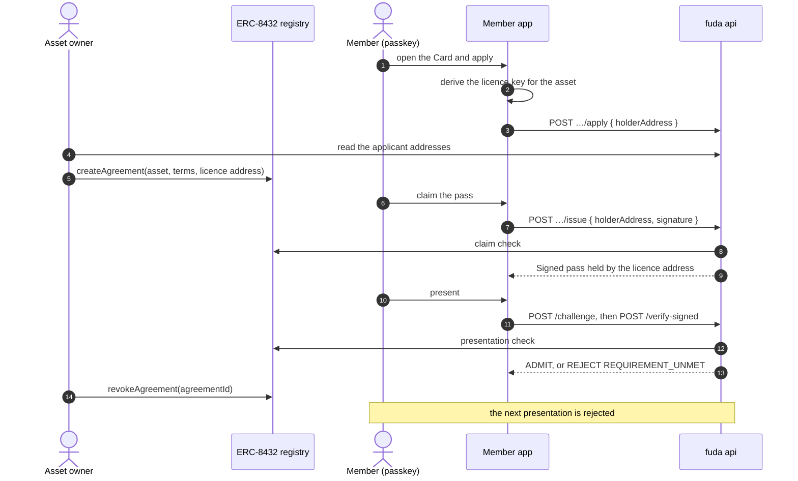

# Card requirements

A Card may carry **requirements**. A requirement names a record outside fuda that a member must hold, such as an ERC-8432 licence agreement. fuda reads that record itself when the member claims a pass, and again each time the member presents the pass. The first kind is `erc8432-agreement`.

**Status: proposed.** Nothing in this document is built. Each pull request on `feat/ip-erc8432` narrows this line to what is still missing.

API paths below are under `/v1`. Terms such as Card, Right, Holder and Member secret are defined in the [glossary](../CONTEXT.md). How requirements relate to the other ways an outside system works with fuda is in the [architecture overview](../architecture.md#outside-systems).

## Rules

- **A requirement belongs to a Card and is fixed when the Card is created**, like `record` and `identity`. The Card body takes an optional `requirements` array of at most four entries. Every route that creates a Card accepts it: the dashboard, `POST /connect/cards` and the MCP `create_card` tool.
- **Every requirement must be met.** There is no "any of".
- **fuda checks a requirement twice.** The claim check runs before a pass is issued and records evidence. The presentation check runs on every signed presentation and reads the chain again.
- **One adapter per kind.** An adapter declares the config schema, the subject it checks, the claim check and the presentation check. Adapters live in `apps/api`. The hosted service loads no third-party adapter.
- **The subject today is an address.** A requirement that checks an address needs a Card with `identity: sensitive`, so the pass is held by a key and presented with a signature. Any other identity answers `400 bad_input`.
- **Contracts are allowlisted per chain.** `@fuda/chains` lists the registries each attestation chain accepts. A requirement that names another contract answers `400 bad_input`. fuda reads only the deployment's own chain.
- **A requirement is never an issuing shortcut.** The MCP `issue_pass` tool and the admin `POST /issue` answer `holder_must_claim` on these Cards, as on any Sensitive Card.

## The `erc8432-agreement` kind

[ERC-8432](https://github.com/sgc-web3/ERCs/blob/ipasset-and-license-registry/ERCS/erc-8432.md) is a draft standard for an on-chain registry of IP assets, licence terms and licence agreements. An agreement binds one asset, one terms record and one holder address. The asset owner grants and revokes it.

```jsonc
{
  "kind": "erc8432-agreement",
  "registry": "0x…", // an allowlisted registry on the attestation chain
  "assetId": "0x…", // bytes32
  "termsId": "0x…", // bytes32, optional: accept only agreements on these terms
}
```

| Check | Reads | Passes when |
| --- | --- | --- |
| Claim | `activeAgreementsOf(assetId, holder, cursor, limit)`, then `agreementOf(agreementId)` | an active agreement held by the address binds the asset, its `creationMode` is `GRANT`, and its terms match `termsId` when one is set |
| Presentation | `isActiveAgreementHolder(agreementId, assetId, holder)` | it answers `true` |

The claim check examines at most 1,000 agreement records of the asset. A claim may name `agreementId` to skip the search; the api then reads that one agreement.

The evidence is one URI, `ipagreement:<chainId>:<registry>/<agreementId>`, stored with the Right in D1. The presentation check reads the agreement that the evidence names.

| Detail               | Meaning                                                                             |
| -------------------- | ----------------------------------------------------------------------------------- |
| `no-agreement`       | the address holds no active agreement on the asset, or the search limit was reached |
| `not-granted`        | the agreement was self-acquired with `acquireAgreement`                             |
| `wrong-terms`        | the agreement is on terms other than `termsId`                                      |
| `agreement-inactive` | the agreement expired, was revoked, was frozen or moved to another holder           |

## The licence key

A member needs no Crypto wallet. The member app derives one key per IP asset from the [Member secret](./pass-types-and-flows.md#sensitive-use), so the member only uses a passkey.

- **Derivation.** HKDF-SHA-256 from the Member secret, with the label `fuda.sh/member-secret/licence-key/v1`. The salt is the SHA-256 of the UTF-8 string `<chainId>:<registry>:<assetId>`, with both hex values in lower case. The result is a secp256k1 key, and its address is the licence address.
- **One address per asset.** Every Card that requires the same asset sees the same address for one member. Addresses for different assets do not link to each other.
- **A plain key.** Signatures are EIP-191. The api recovers the address without reading the chain.
- **PRF is required**, with the same guidance as Sensitive use when a passkey returns no PRF result.
- **Recovery is the Member secret's.** A passkey that holds a copy restores the same address. A member who starts over gets new addresses, and the asset owner revokes the old agreement and grants a new one.
- **The label never changes.** A new label would change every address.

The Vault entry for one of these passes records that its key is a licence key and which asset it belongs to, in place of a random salt.

## Flow



### Routes

| Route | Purpose |
| --- | --- |
| `GET /issuers/:handle` | Each card adds `requirements`, so the member app knows which key to derive |
| `POST /issuers/:handle/:slug/apply` `{ holderAddress, turnstileToken? }` | Adds the address to the Card's applicant list. `{ applied: true }`, also on a repeat. `404 not_found` on a Card with no requirement |
| `GET /issuers/me/cards/:cardId/applicants` | Operator session. `{ applicants: { address, appliedAt }[] }`, oldest first |
| `POST /issuers/:handle/:slug/issue` `{ holderAddress, signature, agreementId?, source?, turnstileToken? }` | The Sensitive claim, with a signature and the claim check |

Apply and claim omit browser credentials, as Sensitive claims do. They share the self-serve budget and the [claim bot check](./pass-types-and-flows.md#claim-bot-check). The applicant list holds the address and the time, and no account id.

### Claiming

The claim signs the string `fuda.sh:claim:v1:<cardId>:<holderAddress>` with the licence key, as an EIP-191 personal message. The api checks in this order, after the Card is found and open and after the bot check.

| Failure                                    | Answer                                                        |
| ------------------------------------------ | ------------------------------------------------------------- |
| no signature                               | `400 bad_input`                                               |
| the signature does not recover the address | `403 bad_signature`                                           |
| a requirement is not met                   | `403 requirement_unmet`, with `requirement: { kind, detail }` |
| the chain cannot be read                   | `502 chain_error`                                             |
| the Card is at capacity                    | `409 card_sold_out`                                           |

A Card issues one pass per address. A repeated claim by the same address answers the pass it already has and reserves no place, so a replayed signature gains nothing.

### Presenting

`POST /verify-signed` runs the presentation check after the signature passes and before a Slot is consumed. A failed check answers `REJECT` with the reason `REQUIREMENT_UNMET` and `requirement: { kind, detail }`. An unreadable chain answers `502 chain_error`, as it does for any Sensitive pass. No result is cached, so a revoked agreement rejects at the next presentation.

`GET /verify/:uid` does not run the check. A preview of these passes is yellow and admits nobody.

An `ADMIT` verdict and the member's pass list show the agreement with a link to the block explorer. The link comes from the evidence URI.

## What reaches the chain

An agreement puts the licence address on a public chain, as an NFT would. Claims, presentations and entries stay off chain. These passes keep every Sensitive limit: no Wallet pass, no QR, no Stamps, no integrations, and an entry log that expires.

## Design choices

- **Requirements are fixed at creation.** A pass keeps the evidence it was issued with. A Card that could change its asset later would hold passes whose evidence names another asset.
- **Only granted agreements count.** Attached terms are an open offer. `acquireAgreement` lets any caller take an agreement on them, and the reference `canLicense` approves any non-zero caller. The asset owner's `createAgreement` is the only path the owner controls.
- **These Cards are Sensitive.** A pass held by a key and presented by signature already exists there, with a claim that takes an address and a verdict that reads no session. The cost is the Sensitive limits above. A fan pass that needs Stamps or a Wallet pass needs a new Card identity, which this design leaves open.
- **The key is per asset, not per pass.** The asset owner grants an agreement to one address before any pass exists. A key per pass would need one agreement per Card.
- **No smart wallet.** A counterfactual wallet's signature carries the passkey's public key, so a member's addresses would link to each other. The Coinbase Smart Wallet factory also has no code on Soneium mainnet.
- **The claim is signed.** Licence addresses are public on chain. Without a signature, anyone could claim the one pass of another member's address.
- **The registry is a draft.** The reference implementation says it is not audited or meant for production. fuda reads it only through the allowlist, deployed unmodified from commit `a2f4291` of the [reference implementation](https://github.com/sgc-web3/erc-8432), and only in the develop environment.
- **An outside system that decides for itself needs no requirement.** It issues through the [MCP server](./mcp.md) and fuda trusts its choice.
