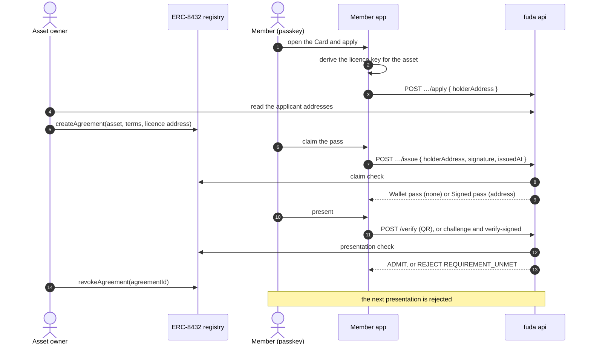

# Card requirements

A Card may carry **requirements**. A requirement names a record outside fuda that a member must hold, such as an ERC-8432 licence agreement. fuda reads that record itself when the member claims a pass, and again each time the member presents the pass. The first kind is `erc8432-agreement`.

**Status: built, not yet usable on a deployed target.** The model, the API, the member app and the dashboard are built. No registry is deployed and `IP_REGISTRIES` is unset on every deployed target, so no Card can carry a requirement there. Nothing has run against a deployed registry. The [runbook](../runbook.md#erc-8432-registry-for-card-requirements) lists the deployment steps.

API paths below are under `/v1`. Terms such as Card, Right, Holder and Member secret are defined in the [glossary](../CONTEXT.md). How requirements relate to the other ways an outside system works with fuda is in the [architecture overview](../architecture.md#outside-systems).

## Rules

- **A requirement belongs to a Card and is fixed when the Card is created**, like `record` and `identity`. The Card body takes an optional `requirements` array of at most one entry. Every route that creates a Card accepts it: the dashboard, `POST /connect/cards` and the MCP `create_card` tool.
- **Every requirement must be met.** There is no "any of".
- **fuda checks a requirement twice.** The claim check runs before a pass is issued and records evidence. The presentation check reads the chain wherever a verdict is produced, including admission, preview, the pass page and Badge submission.
- **One adapter per kind.** An adapter declares the config schema, the subject it checks, the claim check and the presentation check. Adapters live in `apps/api`. The hosted service loads no third-party adapter.
- **The subject today is an address.** A requirement accepts `identity: none` or `identity: address`, with `record: offchain`. The `address` identity needs a requirement. Requirements with `passkey`, `sensitive` or `record: onchain` answer `400 bad_input`.
- **Contracts are allowlisted per deployment.** The api's `IP_REGISTRIES` value lists the registries it accepts, beside the other chain addresses in `apps/api/targets.jsonc`. A requirement that names another contract answers `400 bad_input`. The allowlist is checked again at claim and presentation. A removed registry is unmet with `registry-not-allowed`, without reading that registry. fuda reads only the deployment's own chain.
- **A requirement is never an issuing shortcut.** The MCP `issue_pass` tool answers `holder_must_claim` on requirement Cards and on Cards whose identity is not `none`. The admin `POST /issue` issues a Right outside any Card and takes no Card id.

## Identity decides presentation

The default, `none`, issues an ordinary Standard pass at Bearer level, with no holder key. It works in Apple Wallet and Google Wallet. Anyone holding its QR can show it. Each scan checks the agreement against the address proved at claim, stored in `card_address_passes`. Venue reception can credit Stamps while the agreement holds.

## The `address` identity

`address` is a fourth Card identity, beside `none`, `passkey` and `sensitive`. Each Right is held by an address, and the member presents it by signing a challenge with that address's key. It needs `record: offchain`.

It takes from Sensitive use only how a pass is held and presented: the claim sends an address and reads no session, the pass is Signed, `POST /verify-signed` recovers the address from the signature, and the pass is listed in the member's Vault. An unreadable chain rejects with `502 chain_error`.

It takes none of the Sensitive limits. The entry log keeps the decision and the reason, integrations can be turned on, and the pass routes answer. Like any Signed pass, it has no QR that admits and earns no Stamps at reception.

## The `erc8432-agreement` kind

[ERC-8432](https://github.com/sgc-web3/ERCs/blob/ipasset-and-license-registry/ERCS/erc-8432.md) is a draft standard for an on-chain registry of IP assets, licence terms and licence agreements. An agreement binds one asset, one terms record and one holder address. The asset owner grants and revokes it.

```jsonc
{
  "kind": "erc8432-agreement",
  "registry": "0x…", // an allowlisted registry on the attestation chain
  "assetId": "0x…", // bytes32
  "termsId": "0x…", // bytes32, optional: accept only agreements on these terms
}
```

| Check | Reads | Passes when |
| --- | --- | --- |
| Claim | `activeAgreementsOf(assetId, holder, cursor, limit)`, then `agreementOf(agreementId)` | an active agreement held by the address binds the asset, its `creationMode` is `GRANT`, and its terms match `termsId` when one is set |
| Presentation | `isActiveAgreementHolder(agreementId, assetId, holder)` | it answers `true` |

The claim check examines the 1,000 most recent agreement records of the asset. Anyone can add records with `acquireAgreement`, so searching the oldest records could hide every later grant. A claim may name `agreementId` to skip the search; the api then reads that one agreement.

The evidence is one URI, `ipagreement:<chainId>:<registry>/<agreementId>`, stored with the Right in D1. The presentation check reads the agreement that the evidence names.

| Detail | Meaning |
| --- | --- |
| `registry-not-allowed` | the deployment no longer accepts the registry |
| `no-agreement` | the address holds no active agreement on the asset, or the search limit was reached |
| `not-granted` | the agreement was self-acquired with `acquireAgreement` |
| `wrong-terms` | the agreement is on terms other than `termsId` |
| `agreement-inactive` | the agreement expired, was revoked, was frozen or moved to another holder |

## The licence key

A member needs no Crypto wallet. The member app derives one key per IP asset from the [Member secret](./pass-types-and-flows.md#sensitive-use), so the member only uses a passkey.

- **Derivation.** HKDF-SHA-256 from the Member secret, with the label `fuda.sh/member-secret/licence-key/v1`. The salt is the SHA-256 of the UTF-8 string `<chainId>:<registry>:<assetId>`, with both hex values in lower case. The result is a secp256k1 key, and its address is the licence address.
- **One address per asset.** Every Card that requires the same asset sees the same address for one member. Addresses for different assets do not link to each other.
- **A plain key.** Signatures are EIP-191. Recovering the address needs no chain read. Presentation still reads the chain to check the pass and its agreement.
- **PRF is required**, with the same guidance as Sensitive use when a passkey returns no PRF result.
- **Recovery is the Member secret's.** A passkey that holds a copy restores the same address. A member who starts over gets new addresses, and the asset owner revokes the old agreement and grants a new one.
- **The label never changes.** A new label would change every address.

For `address`, the Vault entry is `{ uid, licence: { chainId, registry, assetId }, venue, cardTitle }`, in place of the per-pass random salt. The app derives the scope from the first ERC-8432 requirement and its configured chain. Applying shows the licence address with a copy action. Receiving again with the same Member secret restores the same pass in the Vault. For `none`, the app shows the QR and platform Wallet action and remembers the pass on the device, without adding it to the Vault or account pass list. Receiving with the same Member secret restores it on another device. The account pass list refuses requirement passes, including Bearer ones, so it cannot link an account to the licence address.

The ready screen for both identities offers “Receive pass again”. Use it when the gate says the agreement is inactive after the owner grants a new one. It repeats the claim to renew the stored evidence.

## Flow



### Routes

| Route | Purpose |
| --- | --- |
| `GET /issuers/me` | Adds `requirementRegistries`, the deployment's allowed registry addresses in lower case, empty when unset. The dashboard offers the requirement section only when this list is not empty |
| `GET /issuers/:handle` | Each card adds `requirements`, so the member app knows which key to derive |
| `POST /issuers/:handle/:slug/apply` `{ holderAddress, turnstileToken? }` | Adds the address to the Card's applicant list. `{ applied: true }`, also on a repeat. `404 not_found` on a Card with no requirement |
| `GET /issuers/me/cards/:cardId/applicants` | Operator session. `{ applicants: { address, appliedAt }[], next }`, oldest first, 100 a page. `next` is the `?after=` value of the following page, or null. A malformed `after` answers `400 bad_input` |
| `POST /issuers/:handle/:slug/issue` `{ holderAddress, signature, issuedAt, agreementId?, source?, turnstileToken? }` | The claim by address, with a signature and the claim check |

Apply and claim omit browser credentials, as Sensitive claims do. They share the self-serve budget and the [claim bot check](./pass-types-and-flows.md#claim-bot-check). The applicant list holds the address and the time, and no account id.

The dashboard offers a separate requirement switch, off by default. Turning it on defaults to `none`, with Wallet and QR support, and also offers `address` for signature presentation. Both use private records. The dashboard validates the registry, asset id and optional terms id before creation. Requirements are read-only afterwards. Applicants appear in their own section, oldest first, with a copy action and a warning that anyone can apply and addresses are not verified.

### Claiming

The holder address is lower case in the claim message. The SDK exports `claimMessage(cardId, holderAddress, issuedAt)`. The claim signs the string `fuda.sh:claim:v1:<cardId>:<holderAddress>:<issuedAt>` with the licence key, as an EIP-191 personal message. `issuedAt` is Unix seconds. A missing time, a time more than 300 seconds old or more than 60 seconds ahead answers `403 bad_signature`. The signature must cover that exact time. The api checks in this order, after the Card is found and after the bot check. A requirement Card verifies the signature before checking the claim window. An address with an existing pass can restore it or renew its evidence outside the window. A new address receives `409 card_closed` outside the window before requirements or capacity are checked. Apply still requires an open window.

| Failure                                    | Answer                                                        |
| ------------------------------------------ | ------------------------------------------------------------- |
| no address or signature                    | `409 holder_must_claim`                                       |
| address but no signature                   | `400 bad_input`                                               |
| the signature does not recover the address | `403 bad_signature`                                           |
| a requirement is not met                   | `403 requirement_unmet`, with `requirement: { kind, detail }` |
| the chain cannot be read                   | `502 chain_error`                                             |
| the Card is at capacity                    | `409 card_sold_out`                                           |

A Card maps each address to its current pass. If that pass expired or was revoked, a qualifying claim issues a replacement and reserves a new place. A used single-use pass stays the address's pass. After the requirements pass, the api reserves capacity with the same mechanism as other passes. D1 commits the unique address mapping, pass and ordered evidence together. A failed batch releases the place; if a concurrent claim for the same address won, the api reads and returns that pass. One case differs: when the concurrent claims compete for a Card's last place, the one that fails to reserve it can answer `409 card_sold_out` before the other has written its pass, and a retry then answers the pass. A crash between reserving and writing can strand a place, as with other passes. A repeated claim for a pass that has not expired or been revoked reserves no place and issues nothing new. It runs the presentation check on the pass the address already has. While that check holds, the claim answers the pass. When it fails, the claim check runs again: a newly granted agreement replaces the pass's evidence and the claim answers the same pass, and otherwise the claim answers `403 requirement_unmet`. A member whose agreement was revoked and granted again keeps the same pass while that pass has not expired or been revoked. To stop a member claiming again, the asset owner revokes the agreement. Revoking only the fuda pass does not stop a new claim.

### Presenting

Every verdict resolution runs the presentation check after the existing pass checks. This includes QR admission, venue reception, signed entry, preview and the public pass page. Signed entry checks the agreement before the holder proof. The check precedes any Slot, Entry, hook, Stamp or Badge write. The requirement subject comes from `card_address_passes`, not the holder key. A failed check answers `REJECT` with reason `REQUIREMENT_UNMET` and `requirement: { kind, detail }`. An unreadable agreement or revocation read answers `502 chain_error`. Requirement passes are never admitted unconfirmed. The pass page shows unknown status when the chain cannot be read. No result is cached.

Reception deliberately answers a repeated request id with its stored receipt without checking again. Stamp adjustment and redemption are the operator's decision and do not read the agreement.

An `ADMIT` verdict carries `requirements: { kind, evidence }[]` in Card order. Clients can derive agreement links from the evidence URI. A pass with missing evidence rejects with `REQUIREMENT_UNMET`.

## What reaches the chain

An agreement puts the licence address on a public chain, as an NFT would. Claims, presentations and entries stay off chain.

## Design choices

- **Requirements are fixed at creation.** A pass's evidence names an agreement on the Card's asset. A Card that could change its asset later would hold passes whose evidence names another asset.
- **A usable pass can take new evidence.** The asset owner may revoke an agreement and grant another to the same address. The evidence is a D1 row beside the pass, so it can change while the pass stays the same. An expired or revoked pass is replaced on a qualifying claim, using another place.
- **Moving an agreement can use several places.** Transferable terms or an ERC-721 agreement let each holder in turn claim a pass. Each claim uses a place. fuda does not reclaim those places when the agreement moves.
- **Freezing an asset does not stop admission.** In the reference implementation it does not deactivate the asset's agreements. fuda keeps admitting until the agreement itself is revoked, frozen or expired.
- **Only granted agreements count.** Attached terms are an open offer. `acquireAgreement` lets any caller take an agreement on them, and the reference `canLicense` approves any non-zero caller. The asset owner's `createAgreement` is the only path the owner controls.
- **Wallet is the default.** A requirement decides whether a member qualifies. Identity decides how the pass is presented. `none` keeps the Wallet and QR benefit. An Issuer chooses `address` when a copied QR must not admit, because only the licence key can present that pass.
- **Wallet stays visible.** A Wallet card and an installed Apple pass stay as they are after an agreement ends. Wallet status comes from the pass itself. The next scan checks the agreement and rejects it.
- **The key is per asset, not per pass.** The asset owner grants an agreement to one address before any pass exists. A key per pass would need one agreement per Card.
- **No smart wallet.** A counterfactual wallet's signature carries the passkey's public key, so a member's addresses would link to each other. The Coinbase Smart Wallet factory also has no code on Soneium mainnet.
- **The claim is signed.** Licence addresses are public on chain. Without a signature, anyone could claim the one pass of another member's address.
- **The registry is a draft.** The reference implementation says it is not audited or meant for production. fuda reads it only through the allowlist, deployed unmodified from commit `a2f4291` of the [reference implementation](https://github.com/sgc-web3/erc-8432), and only in the develop environment.
- **An outside system that decides for itself needs no requirement.** It issues through the [MCP server](./mcp.md) and fuda trusts its choice.
