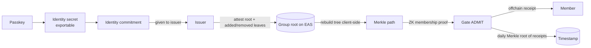

# Pass types and flows

This document explains which fuda template fits a use case, what the member does during onboarding, and which pass and holder type the resulting right uses. The template is a product-policy choice; Bearer and Signed remain the verification rules applied by the gate.

A Card now chooses where its passes are recorded. New Cards default to `offchain`, which signs a pass with no transaction and no holder address; see [Offchain rights](./attestation-model.md#offchain-rights). The on-chain description in this document applies to Cards with `record: onchain`. [Pass types](#pass-types) lists the types and why offchain is the default. Identified passes and Sensitive use are built. Delegated keys remain proposed.

API paths below omit `/v1` except where shown explicitly; pass, asset, gateway, and health URLs are unversioned. See [API versioning](./attestation-model.md#api-versioning).

## Pass types

The Issuer chooses a type per Card, separately from the `membership | ticket` category. Moving a pass to another type means reissuing it under a new UID.

| Type | Verification level | Record | Member address | Presentation | Chain unreadable |
| --- | --- | --- | --- | --- | --- |
| **Standard** (default) | Bearer | signed attestation in D1, batched root | none | secret UID in a QR, Device wallet | membership admits as unconfirmed; ticket rejects |
| **Identified** | Signed | as Standard | none, public key checked directly | challenge answered in the app | as Standard |
| **On-chain** | Bearer | on-chain attestation | fuda-owned counterfactual account | public UID in a QR, Device wallet | rejects |
| **On-chain self-held** | Signed | on-chain attestation | the member's own, stable | challenge answered in the app | rejects |

**Sensitive use** is a Card setting on Identified, for employee badges and privacy-sensitive memberships. It adds per-pass keys, rejects when the chain is unreadable, keeps the entry log to a minimum with a set retention period, turns Attendance and Stamps off, and disables member names. It does not hide entry from the Issuer or the gate; that still needs [anonymous membership](#u4-anonymous-membership-v2-design-not-implemented).

### Why offchain is the default

Decided 2026-11-04. When every Right was a public on-chain attestation, a self-serve claim waited for a transaction, and the holder, issuance and Attendance were public and permanent. We found no evidence that individual shops pay for public verifiability, and it cost them visit privacy and issuance speed. A plain database would remove those costs but make every validity check depend on fuda. An offchain attestation sits between the two: issuance is a signature with no transaction, revocation is still readable on chain by anyone holding the signed data, and a Merkle root can timestamp a batch without publishing its contents.

What this costs:

- fuda holds a link between members and their passes, which the earlier design avoided. Sensitive use limits what that link can reveal, but fuda and the Issuer can still join them.
- Without fuda, a holder of the exported signed data can check validity, but nobody can admit Standard or Identified passes through fuda's gate, and single-use tickets lose their only slot record.
- Validity is a signature plus an on-chain revocation read, not a chain record alone.
- fuda pays for roots and revocations, and on-chain types keep paying per issuance.

### What left the product

- **+Private issuance and its stealth-address templates.** Against a chain observer, an offchain right reveals less than a stealth attestation, and neither hides anything from the Issuer. Sensitive use replaces it. The `/private` discovery path, the announcement log and its Graph data source went with it.
- **Activation and the Claim key.** On-chain self-held rights are issued to the member's key from the start. An On-chain pass moves to self-held only by reissue.
- **The Agent key.** It was to be a fuda-held owner on the Issuer's wallet; a hot key must not be a wallet owner.
- **The Substreams packages.** Nothing consumed them once announcements stopped. They are kept under [`archive/substreams`](../../archive/substreams), unbuilt.

### Open conditions

- **Real devices.** One iPhone has created and used a synced P-256 passkey in two providers. Apple Passwords returned a stable PRF result, also after syncing to a Mac; a Google Password Manager passkey created in Chrome on a Mac did too; Bitwarden returned none. Still open: Android, and server-side verification of a real device's signature. Reports describe PRF failing over the cross-device flow, which we have not confirmed.
- **Recovery of the wrapped secret** is specified under [Sensitive use](#sensitive-use) but not yet tried on those devices.
- **Sponsored wallet operations.** Only EntryPoint 0.6 support has been read from one public endpoint.
- **Soneium.** The Coinbase Smart Wallet factory has no code at its usual address on Soneium mainnet, so on-chain self-held and delegated keys need another path there.
- **Demand.** Whether shops accept the default type and its recovery, and whether Sensitive use has real customers.

## Choose by use case

Templates and the self-serve handle route are the product model. The api derives a right's level from the keys present in the request on the admin `POST /issue`; the self-serve route `POST /issuers/:handle/:slug/issue` issues `standard` (Bearer) rights, or Identified ones on a passkey Card, under the issuer's card (see [Issuer onboarding and the handle route](#issuer-onboarding-and-the-handle-route)); the `fuda.sh` apex redirects `/@*` to `app.fuda.sh`; other apex handling is outside this repository.

**The template is the issuer's choice, made at issuance time.** The intended design is that the issuer configures which templates are available and sets the default, an authorized operator selects one when issuing a right, and a self-service flow such as `fuda.sh/@wassie-coffee` binds the route to a template in advance. None of this is implemented: no setting or request field names a template, and templates exist only in this document. Today the level follows from the rule above.

The onboarding flow behind each column is detailed in the sections below. U4 is a v2 design and is not implemented; its column shows the intended product behaviour, not something the api offers today. Legend: ◎ effortless · ◯ supported, with some setup or conditions · △ partial · − not provided.

|  | **U1: `standard`** | **U4: `anonymous`**<br>v2 design — not implemented |
| --- | --- | --- |
| **Typical uses** | shop membership and stamp cards / retail loyalty / community, coworking, gym, club / event and concert tickets / recurring venue or event passes | privacy-sensitive memberships where no per-visit on-chain record may exist at all, and revocation may lag one root rotation |
| **Sign-up** — what it takes to get the first pass | **◎**<br>save the pass in one-tap and use it right away | **◯**<br>create a passkey before enrolment; first entry waits for the next root rotation |
| **Ownability** — the card is controlled by your own key | **△** ¹ | **◯** ³ |
| **Restore** — getting the card back on a new phone | **◎** ² | **◯** ³ |
| **Decentralization** — the card keeps working without fuda | **△** ¹ | **◯** |
| **Private** — your visits stay unlinkable to you on-chain | − | **◎**<br>no per-member record on chain |
| **Loyalty** — points and history build up in one place | **◯** | − |
| **Name** — `<member-no>.<issuer>.fuda.eth`, see [ENS naming](./ens-naming.md) | **◯**<br>resolves to the stable holder | **△**<br>derived member number; resolution not yet specified |

1. A `standard` right is held by a fuda-owned account, and the member never holds its key. A member's own key can hold a right only through direct Signed issuance on the admin route, to an address the member controls.
2. The pass comes back with the platform's own device restore, a pass re-download, a saved link or a backup file (see [Keeping a pass without a provider](#keeping-a-pass-without-a-provider)). The right itself is an on-chain attestation at a stable holder address, never data stored on the phone, so a restored pass brings back the card, points and history unchanged.
3. U4 keys derive from a passkey-held identity secret that is also exportable, so a `fuda.sh` passkey is not the only key that can hold it. The membership tree and the member's Merkle path are rebuilt from the issuer's on-chain root attestations, with no fuda server.

## Standard issuance

Standard uses `standard` for shops, communities, loyalty cards, stamps, tickets, and other rights where instant acquisition matters more than hiding the right's public history.

1. The member opens a handle route such as `fuda.sh/@wassie-coffee` and requests a card without creating an account or connecting a crypto wallet.
2. fuda creates an opaque member identifier and derives a counterfactual smart-account address that fuda owns. The address is known before the account is deployed.
3. The issuer attests the Entitlement to that address and returns Apple, Google, and browser-based pass destinations after the on-chain UID is confirmed.
4. The member can immediately present the saved pass as Bearer.

The member never takes control of that account, so a Standard right is always Bearer. A right that must answer a Signed gate challenge is issued directly to an address the member controls, a member EOA or a compatible smart wallet, through the admin `POST /issue`.

## U4. Anonymous membership (v2 design, not implemented)

**Status.** U4 is the post-hackathon v2 template. Nothing in this section exists today: no api route accepts `anonymous`, the gate has no proof path, and the member app has no enrolment screen. The section records the intended product flow so the template has a home next to U1; this section is its only source, and what is still open is listed as such below.

U4 uses `anonymous` for privacy-sensitive memberships where the venue must publish no per-visit record and should not learn which of its members entered. U4 has no per-member on-chain record at all. The member proves membership in an issuer-attested group. No Entitlement is attested for the right; its verification level is marked by the record type.

1. The member enrols a passkey and derives an identity secret locally. The secret is exportable, so the passkey bound to `fuda.sh` is not the only key that can hold it.
2. The member gives the issuer an identity commitment — a leaf, not an address.
3. The issuer attests the group's Merkle root on EAS. The attestation data carries the leaves added and removed since the previous root, so the tree is reconstructable from chain alone; no separate contract holds it.
4. The member rebuilds the tree from the issuer's root attestations and computes their own Merkle path locally. No fuda server is involved.
5. At the gate, the member answers the challenge with a zero-knowledge membership proof against the current attested root, produced in the browser. The gate verifies the proof against the root it reads from EAS. This is the **Proved** level.
6. The gate writes no Attendance. It hands the member an offchain receipt and timestamps a daily Merkle root of the receipts it issued.



**What an issuer choosing U4 accepts.** Both points are stated to the issuer at template selection:

- Revocation lags. Removing a member takes effect at the next root rotation, so revocation acquires a lag equal to the issuer's root-rotation grace window.
- First entry waits. A newly added member can enter only once a root that includes their leaf has been attested.

**Member number and name.** A U4 member number is derived, not issued: `encode28(H(secret, issuer))` plus the standard check character from [ENS naming](./ens-naming.md#member-number). It is recomputable without fuda and differs per issuer. What a U4 name resolves to is not yet specified.

**Verification level.** Proved would be a third verification level beside Bearer and Signed.

**Decisions already made** (2026-09-06).

- **Membership groups are EAS attestations, not a separate contract.** The issuer attests roots with the added and removed leaves in the data, so the tree is reconstructable from chain and the member's Merkle path needs no fuda server.
- **`level` stays on the Entitlement schema.** It is the issuer's presentation requirement and must be third-party enforceable. A Proved right has no Entitlement; its level is marked by record type.
- **Delegation is validated, never required.** Resolvers reject an invalid delegation but accept a right with none as self-issued. Gates decide between "fuda network" and "allowlist" trust. fuda is needed to join its trust network, not to issue.
- **Lineage uses `serial`.** The reserved field carries the predecessor UID.
- **fuda leaves the core.** The identity secret is exportable, so a passkey bound to `fuda.sh` is not the only key; delegation is optional; the name gateway is a stateless function of chain data.
- **One v2 schema cut.** Schema changes that alter UIDs are bundled behind the accepted-version set, so v1 rights keep verifying.

**Not yet specified.** Nothing has decided, and this section does not invent: the proof system and circuit; how the proof binds to the gate challenge and resists replay; the wire shape of a Proved gate exchange; whether a Proved right has a pass; the receipt format and where the daily root is timestamped; name resolution for a U4 right.

## Member sign-in

A member account is identified by its passkeys, with no address and no email. Using a pass needs no account: a claim is still one tap. An account is what keeps a member's passes across devices.

| Route | Purpose |
| --- | --- |
| `POST /auth/member/register/options`, `POST /auth/member/register` | Create an account with a first passkey. The account exists only once that passkey has verified. Answers `{ accountId, token }` |
| `POST /auth/member/login/options`, `POST /auth/member/login` | Sign in. No credential is named, so the system lists the passkeys it holds for this site. Answers `{ accountId, token }` |
| `GET /auth/member/me`, `POST /auth/member/logout` | Read and end the session |
| `GET /auth/member/passkeys` | The account's passkeys: `{ id, backedUp, createdAt, lastUsedAt }` |
| `POST /auth/member/passkeys/options`, `POST /auth/member/passkeys` | Add a passkey, up to 10, or `409 passkey_limit` |
| `DELETE /auth/member/passkeys/:id` | Remove one. `409 last_passkey` if it is the account's last or is not the account's |
| `GET /member/passes`, `POST /member/passes { uids }` | The passes the account keeps, and linking up to 50 at once |
| `POST /auth/member/passkeys/authorize/options` | A fresh assertion challenge from an existing account passkey, bound to `authorize-add` |
| `POST /auth/member/claim/options` | A challenge for [claiming an Identified pass](#claiming-an-identified-pass), naming the account's passkeys |

**Ceremonies.** Passkeys are ES256 and discoverable, with user verification required and attestation `none`, for the relying party in `WEBAUTHN_RP_ID` and the origins in `WEBAUTHN_ORIGINS`. A challenge is one-time, expires after 300 seconds and is bound to its purpose, and for adding a passkey or resetting recovery to its account. A wrong response burns it. A refused ceremony answers `401 bad_passkey`, and malformed input `400 bad_input`. The ceremony routes share a budget of 60 requests per IP per hour. Passkeys need no PRF, so any provider works.

**Adding a passkey.** When the account already has a passkey, both `POST /auth/member/passkeys` and `POST /auth/operator/passkeys` require `authorization`, a fresh assertion from an existing passkey on this account answering the same audience's `/auth/{member|operator}/passkeys/authorize/options`. It is single-use, expires after 300 seconds, requires user verification, and cannot be replaced by a login, claim, or reset assertion. The shared ceremony enforces this for both audiences. It answers `403 bad_passkey` for missing or refused authorization without ending the valid session. This prevents a stolen session from registering an attacker passkey and using it to reset recovery. Dash asks for the existing passkey before prompting to save the new one.

An account with no passkeys can add its first using the authenticated account session and the account-bound, single-use registration challenge, with the same origin, relying-party and user-verification checks. No existing key can authorize that operation. A wallet-only operator has no Account and these management routes still answer `409 no_account`; `/auth/operator/register` creates a separate account only after verifying its first passkey. It does not attach that account to the wallet's Issuers. Both audiences refuse removal of the last passkey or the last member-secret copy holder.

**Passes.** Only Bearer rights link, because having the uid is what using one means, so a link grants nothing new. Two accounts may keep the same pass. A uid that names nothing, and a Signed right, is skipped without saying which. On `/rights` the app sends the passes this device remembers and brings the account's others to this device. If that fails, the device's own list still works. fuda therefore knows which passes an account keeps. An offchain right has no holder address to query, which is why the list is kept on the server; on-chain rights are still found from an address.

**Moving devices.** A passkey synced by the provider signs in on the new device, and the list follows. Between providers that do not sync, such as iCloud and Google, the member signs in on the new device with the old one through the system's cross-device prompt, then adds a passkey in Settings. A passkey in a second place, such as another password manager or a security key, also survives losing an Apple or Google account.

### Claiming an Identified pass

An Identified pass is bound to a passkey, so a screenshot of its QR does not admit. It needs an account, which gives up Standard's one-tap claim. An Issuer chooses this per Card with `identity: passkey`.

1. The card page sends a signed-out member to `/signin`, which returns to the card with its address intact, including any `?source=`.
2. The app asks `POST /auth/member/claim/options` for a challenge. It is one-time, expires after 300 seconds, and is bound to this account and to the purpose `claim`.
3. The member's passkey answers, and the app sends `POST /issuers/:handle/:slug/issue { source?, webauthn }` with the session. The api checks that it is one of this account's passkeys, then signs that credential's ID and public key into the pass.

The answers are `401 unauthorized` without a member session, `400 bad_input` without an assertion, and `403 bad_passkey` for a refused one, which burns the challenge. Capacity is reserved as for any claim, and the pass is linked to the account in the same batch as its rows. An account may claim a Card more than once, and each claim is a new pass.

The pass has no QR that works and no Wallet pass that would. The card page and `/rights` show the pass with an entry action leading to `/signed?uid=<uid>` and say why. `GET /pass/:uid` and the Wallet routes still answer for it, as for any Signed right, but the member app does not offer them. Because reception reads a QR, it answers `LEVEL_REQUIRED` for these passes, so they do not earn Stamps there.

A replacement is the Issuer revoking the pass and the member claiming a new one.

### Keeping a pass without a provider

fuda holds no email or other contact detail for a member, and does not send them mail. Linking an email, even stored only as an HMAC, would add personal data and a mail provider, and would let whoever takes over the mailbox into the account. A Standard pass does not depend on an account or on Apple or Google, so what a member can lose is finding it again, and there are three ways back:

- **The saved pass.** The Wallet pass's "Open in fuda" link is `/@<handle>/<slug>?uid=<uid>`. The card page takes the uid out of the address, asks `GET /pass/:uid/backup`, and if the pass belongs to that card, remembers it on this device and shows it instead of offering a second one. Otherwise it behaves as if no uid was given.
- **A backup.** The card page and `/rights` offer `GET /pass/:uid/backup` as a file: `{ version, uid, qr, holder, handle, slug, memberNumber, restoreUrl, attestation, proof }`. `attestation` is the signed offchain attestation, or null for an on-chain right. `proof` is `{ root, path, anchoredAt }` once the pass's batch has been timestamped, or null. Settings reads a file back, using only its uid and asking the api about the rest. The route is public and `no-store` like `/pass/:uid`. Having the file means being able to use the pass, and the screens say so.
- **The shop.** A reissue, under a new uid.

An Identified pass answers to its passkey, so these bring back its record and not the use of it, and the screens say so. It works on a new device through passkey sync. Otherwise it takes the shop's revocation and a new claim. A passkey removed from the account keeps working on passes that name it until they are revoked, because the attested key is the authority ([attestation model](./attestation-model.md#offchain-rights)).

Recovery by type:

| Type               | Recovery                                                                         |
| ------------------ | -------------------------------------------------------------------------------- |
| Standard           | a saved pass's link; a backup file; passkey account; reissue at the shop         |
| Identified         | passkey sync; otherwise reissue, because the pass names one passkey's public key |
| Sensitive use      | passkey sync; a second passkey; reissue by the Issuer                            |
| On-chain           | as Standard; the record stays public                                             |
| On-chain self-held | passkey sync, owner rotation or an external wallet                               |

Moving between iOS and Android does not carry a passkey across, so the new phone needs an existing device or a reissue.

A wallet is no longer a way to sign in. Connecting one on `/rights` or `/signed` still works on that device for looking up and presenting on-chain rights. `/signed` reads the pass first: for an Identified or Sensitive pass it offers only the passkey, and otherwise the wallets.

### Sensitive use

For employee badges and privacy-sensitive memberships. An Issuer chooses this per Card with `identity: sensitive`, which needs `record: offchain`. Each pass attests a key of its own. Pass records and gate proofs contain no account identifier or key shared across venues. Claims, challenges, and signed presentations omit browser credentials, including cookies; the app proxy also forwards no member session or cookie on those requests. They send only the pass-specific inputs, optional claim source, and Turnstile token. This prevents direct linking by an account credential, not all correlation. The service can still observe IP addresses, user agents, request timing, and an authenticated vault write immediately after a claim. The Issuer and gate can observe entry, and the same pass remains recognizable across its uses.

**Wallet exclusion.** A Sensitive Right has no Apple or Google Wallet pass. Public pass, save-link, pkpass and backup routes and authenticated Apple registration and download routes answer `404 not_found`. Revocation and pass, Card or Issuer updates send no Sensitive UID, data or push to either platform, even if an Apple registration already exists. Apple device update lists exclude these serials. Wallet eligibility is checked before Google OAuth or object requests and before Apple update selection.

**Entry retention.** Sensitive scans retain only an entry-log row id, the Right UID, and the scan time. The UID identifies the Card whose retention applies, the time determines expiry, and the id identifies the row for deletion and reception receipts. Decision, reason, entry path, Attendance UID, and reception id are null. Verdicts still return their usual fields to the caller. Reception keeps its original response in an idempotency receipt until that entry expires.

A daily job deletes Sensitive entry rows strictly older than 30 days and their reception receipts in one transaction. Rows at the cutoff remain until a later run. Expired Sensitive challenges are also removed so their use times cannot outlive the log when no later challenge mint sweeps them. Each run handles at most 800 entries and 800 challenges, checks its time budget between batches, and leaves any remainder for the next run. A backlog or failed run can extend retention beyond 30 days; the runbook describes how to check it. Other Cards' logs, receipts, and Stamp credits keep their existing retention.

A Sensitive single-use Slot keeps only the fact of consumption, with `consumed_at = 0`. It remains after the entry log expires, so a new signed challenge still rejects with `ALREADY_USED`. Dashboard and member lists count issued Rights and read consumption from Slots, so purging entries does not change their counts or produce an unknown state. The shared 30-day period is the initial policy; employee badges may need a longer audit period.

**The member secret.** 32 random bytes made in the browser, the first time a member claims one of these cards. Each passkey that can hold it wraps it with AES-GCM, under an HKDF key from that passkey's WebAuthn PRF output for the fixed salt `fuda.sh/member-secret/prf/v1`. The server stores only `member_secret_copies(account_id, credential_id, iv, ciphertext, created_at)` and never sees the secret or a PRF output. A copy goes with its passkey, and an account cannot remove the last passkey holding one. The client also derives a 32-byte write token with HKDF-SHA-256, empty salt, and the separate label `fuda.sh/member-secret/write/v1`. The server stores only its SHA-256 hash in `accounts.secret_write_hash`, set atomically with the first copy. Every later copy and every vault write requires this token, checked in constant time. A session alone cannot replace the vault or plant a copy to bypass the last-copy protection. The token is confined to authenticated recovery requests and never accompanies a claim or presentation.

**A passkey without PRF.** A browser reports the feature whatever the passkey provider does, so only a result counts. A prompt that returns none stops the claim before anything is issued. The card page says that a website cannot choose the provider and names the ones that work, iCloud Keychain and Google Password Manager, and offers to save a new passkey and carry on with that one. Every passkey is asked to enable the feature when it is created, since some enable it only then. The first opening counts its outcome in `member_secret_outcomes(outcome, total)`, a number per outcome with no account, device or time.

**A pass's key.** secp256k1, derived with HKDF-SHA-256 from the member secret with a random 32-byte salt per pass. The claim sends `POST /issuers/:handle/:slug/issue { holderAddress, source? }`. The route reads no session, and answers `400 bad_input` without an address. The address goes into `holderKey` and nowhere else: the `members` row keeps a null holder, and `member_passes` gets no row. `POST /member/passes` skips these uids, as it does any Signed right. The admin route and the MCP `issue_pass` tool answer `holder_must_claim`.

**The list.** The account's vault is one ciphertext in `member_vaults(account_id, iv, ciphertext, version, updated_at)`, sealed under a key derived from the member secret, holding `{ uid, salt, venue, cardTitle }[]`. `/rights` shows a section only if the account holds a copy, and opens it with a passkey prompt on request, never on load. It asks nothing about any one pass until the member enters with it, so it shows no status, and a revoked pass is still listed until entering reports it. Entering from the list takes no second prompt, because the secret is still open on that screen.

A vault write names the version it read, and a stale one answers `409 vault_conflict`. The device then reads the current vault, adds its entry and tries again, because a lost salt is a lost pass. A device never writes over a vault it cannot open. A claim is two requests, since the uid exists only once the api has signed, so if the second fails each entry waits under its own local storage key, sealed under the same key, and is added the next time the list opens on that device. Concurrent claims never replace one shared pending ciphertext. Recovery removes only the pending entries included in a confirmed vault write, leaving entries added while the write was in flight. Once issuance succeeds, persistence failures still return the issued pass with `saved: false`, and the card page shows entry with a warning instead of offering to issue again. If local storage is unavailable or refuses the pending write, that device cannot retain the entry for recovery.

**Presenting.** `/signed` and the list use the usual challenge. `POST /challenge` names no passkey for these passes, so the app opens the secret, finds the pass in the vault, derives its key and signs the challenge string. The api recovers the address and compares it with `holderKey`, reading no chain for that step ([attestation model](./attestation-model.md#offchain-rights)).

**A second passkey.** Adding a passkey to an account with a member secret needs both PRF results, one to unwrap and one to wrap. An old passkey opens the secret locally, then an existing account passkey authorizes adding the new passkey with a fresh assertion. The new passkey is created next, and a further prompt is needed only if that provider gives no PRF result at creation. Settings explains this first. A new passkey with no PRF result is kept for sign-in and holds no copy, and Settings marks which passkeys open these passes. A copy may be added only beside an existing one, and the first only while there is none, so two devices enrolling at once cannot start two secrets. The loser answers `409 secret_conflict`, and carries on with the winner's secret if it used the same passkey. With a different one it cannot open it, and adds that passkey from the winning device. A stolen session can read these ciphertexts but cannot decrypt or change the recovery data without the write token or a fresh account passkey assertion.

**Starting over.** With no passkey that opens the secret, a member cannot open the list or claim another of these passes, and the last passkey with a copy cannot be removed. `/rights` offers Start over only when a passkey cannot open the saved secret. Cancelling the passkey prompt offers a neutral message and retry. A passkey without PRF gets an explanation that it cannot open Sensitive passes, and a signed-out member gets a sign-in link. A service failure offers retry. New attempts clear earlier feedback, and a failed entry hides the opened list. Starting over requires a fresh, user-verified assertion from an existing passkey on this account. The challenge is bound to this account and the purpose `reset`, expires after 300 seconds, and is spent once even if verification fails. Login, claim, and add-passkey assertions cannot authorize reset. The account's passkey need not produce PRF. With no account passkey left, the member cannot start over on this account and creates a new account instead.

Start over clears the account's copies, vault, and write-token hash, and clears pending encrypted entries and opened keys on the initiating device. It does not cancel old passes. A device that still holds an old pass's key can continue to use it. The server cannot find all passes for an account because it holds no readable link between them. To cancel an old pass, the member asks the shop or organization to revoke it. The warning states this in English and Japanese. A new secret can then start, and the member claims new passes. Adding a passkey while the secret will not open still works after an existing account passkey authorizes it; that new passkey is for sign-in only.

| Route | Purpose |
| --- | --- |
| `GET /member/secret` | `{ rpId, allowCredentials, copies }`. `allowCredentials` is every passkey until a copy exists, then only those with a copy |
| `POST /member/secret` | `{ credentialId, iv, ciphertext, first, writeToken }` adds a copy. `400 bad_input` for missing proof, `403 secret_proof_required` for a wrong token. `409 secret_conflict` if refused |
| `POST /member/secret/reset/options` | A reset challenge naming this account's passkeys |
| `DELETE /member/secret` | An authentication assertion clears the account's copies and vault and write-token hash. `{ cleared: true }`, `400 bad_input` without an assertion, `403 bad_passkey` if refused |
| `POST /member/secret/outcome` | `{ outcome: 'prf' or 'no_prf' }` adds one to the count |
| `GET /member/vault` | `{ vault: { iv, ciphertext, version } or null }` |
| `PUT /member/vault` | `{ iv, ciphertext, expectedVersion, writeToken }` answers `{ version }`, `400 bad_input` for missing proof, `403 secret_proof_required` for a wrong token, or `409 vault_conflict` |

All of them need a member session. Reset options and assertions share the 60-request-per-IP-per-hour ceremony budget. Sensitive claims use the existing self-serve budget of 20 requests per IP per hour. Every Sensitive claim requires a Turnstile token when the deployment has TURNSTILE_SECRET_KEY, before it can reserve capacity. The claim still omits account credentials. `GET /auth/member/passkeys` adds `holdsSecret` to each passkey.

**What these cards do not have.**

| Feature | Behavior |
| --- | --- |
| Chain unreadable | Rejects with `502 chain_error`, even for a membership |
| Attendance | None, as for any offchain right |
| Stamps | `PUT /issuers/me/cards/:id/stamps` answers `409 stamps_not_supported`, and reception answers `LEVEL_REQUIRED` |
| Integrations | `PUT /issuers/me/cards/:id/integrations` answers `409 integrations_not_supported`, because a human Badge's nullifier is the same at every venue |
| Wallet pass, QR, pass page, backup file | `GET /pass/:uid` and its `card`, `backup`, `google` and `apple.pkpass` routes answer `404 not_found` |
| Member name | None, as for any offchain right |
| Device memory | Neither `fuda.passes.v1` nor the card memory keeps the uid, so a later visit to the card page offers a claim and points to `/rights` |

Recovery is passkey sync, a second passkey, or the Issuer revoking the pass and the member claiming a new one, starting over first if the secret no longer opens.

**Why a member secret, and what it does not give.**

- **Smart wallets do not give this separation.** An undeployed wallet's signature contains the owner's public key, so per-venue wallets behind one passkey stay linkable.
- **This is not network anonymity.** Claim, challenge and presentation requests omit account credentials, but IP addresses, user agents and timing still permit correlation.
- **One passkey per card is not built.** It is the fallback if PRF loses too many members. Each card would get its own discoverable passkey, and fuda would keep a map from credential ID to pass that is not linked to an account. It works with any provider but adds a second recovery path, and several passkeys on one RP ID have not been tested.
- **A member address is not created at issuance.** When an integration needs one, it derives from the member secret, per venue by default. Stealth addresses stay available as a way to receive value, not as a pass type.

The dashboard's pass list and counts keep working from `members` rows, which identify nobody. Its row for one of these passes has no QR or pass links, which `sensitive: true` on `GET /members` tells it. `entry_log` keeps minimized rows for 30 days, then the daily retention job purges them and their reception receipts.

## Issuer onboarding and the handle route

The U1 first-pass flow is self-serve. An operator creates a venue and its cards in the dashboard; a member gets a card from the handle route with no account and no wallet.

**Operator sign-in.** An operator signs in with a passkey, and connecting a wallet is optional, because Base Account sign-up asks for an email and makes a wallet the identity. Accounts are shared with members: a person who runs a shop and holds passes is one person with one passkey, and only the session audience differs. The routes mirror [Member sign-in](#member-sign-in), and a session's token is presented as `Authorization: Bearer` on the operator routes, lives 30 days, and is stored hashed.

| Route | Purpose |
| --- | --- |
| `POST /auth/operator/register/options`, `POST /auth/operator/register` | Create an account with a first passkey. Answers `{ accountId, issuer: null, token }` |
| `POST /auth/operator/login/options`, `POST /auth/operator/login` | Sign in. Answers `{ accountId, issuer | null, token }`, bound to the account's oldest issuer |
| `GET /auth/operator/me` | `{ accountId, address: null }` for a passkey session, `{ accountId: null, address }` for a wallet session |
| `POST /auth/operator/logout`, `POST /auth/logout` | End the session, however it signed in |
| `GET /auth/operator/passkeys`, `POST /auth/operator/passkeys/options`, `POST /auth/operator/passkeys`, `DELETE /auth/operator/passkeys/:id` | As for a member. A wallet session has no account, and these answer `409 no_account` |

The ceremonies are the [shared ones](#member-sign-in). The dashboard Worker's `POST /session/passkey { flow, response }` spends the browser's answer, refuses a cross-site write, and keeps the token in the HttpOnly operator cookie, so the browser never holds it. A member token is refused on the operator routes and an operator token on the member routes. The profile page lists, adds and removes passkeys on a venue an account owns.

**Wallet sign-in.** "Sign in with a wallet" stays as a secondary link, on the sign-in screen and the connected-app consent page, because an ENS claim needs a wallet and a voucher needs an address. `POST /auth/challenge { address }` answers `{ nonce, message }` where `message` is `fuda.sh dashboard sign-in\nnonce: <nonce>`; the wallet personal-signs it and `POST /auth/verify { address, nonce, signature }` answers `{ token, issuer | null }`. The signature is checked through the chain client (EOA, ERC-1271, ERC-6492), so an undeployed Base Account signs in. A nonce is one-time, bound to the address, and expires with the gate's 300 s TTL; a wrong signature burns it. The admin token is not an operator identity and is not accepted on operator routes.

**Ownership.** An issuer belongs to exactly one owner: an account, or an address for one made through a wallet sign-in. The table holds that with a check. A session acts for what its own principal owns, so a passkey session reaches its account's issuers and a wallet session its address's, and neither reaches the other's. There is no way to move an issuer between them, so an account's issuer cannot claim an ENS name. The columns that name an owner keep their old names (`connected_apps.owner_address`, `oauth_codes.address`, `oauth_tokens.address`, `connected_app_events.address`, `stamp_credits.operator_address`) and hold an address or `account:<id>`, because renaming them would break the previous Worker on a rollback. `IssuerView.operatorAddress` is null on an issuer an account owns.

**Issuer wallet identity.** The address verified at a wallet sign-in is the lookup key for the issuers it owns. For a smart wallet it is the account address, not an individual owner credential; an owner's ordinary personal signature is not interchangeable with that wallet's ERC-1271/ERC-6492 proof. The current API can verify account proofs but the dashboard exposes no co-owner discovery, invitation, owner-management or credential-specific audit UI. Existing bearer sessions are not invalidated by an onchain owner change. One owner may hold several issuers, each with its own handle, cards and data.

**Shared issuer wallet (not built).** Decided 2026-09-09 for issuers a wallet owns. The wallet is the issuer's durable identity; the credentials controlling it can change without changing the issuer, handle, cards or ENS owner. Full co-owners use Coinbase Smart Wallet's MultiOwnable. An owner credential is not a separate issuer, and no offchain allowlist is the authority for the wallet. Co-owner onboarding and owner management are not built.

- **Sign-in proves control of the issuer wallet.** An owner's personal signature against its own address does not. A co-owner flow needs the target wallet, a supported signer and a correctly encoded wallet proof.
- **MultiOwnable grants full control to each owner.** It is not a threshold multisig or a role system. Reception-only operators and automated keys need a separate design.

Before owner management ships:

- **Credential removal must end access.** Sessions last 30 days and are not revalidated against on-chain owner state.
- **Chain scope must be explicit.** Sign-in verifies on Base Sepolia and ENS runs on Ethereum Sepolia; equal addresses do not imply equal owner state.
- **Signer discovery must be usable.** No wallet switcher or invitation flow exists.

`pnpm --filter api probe:venue-wallet` verifies the signature premise with two initial owners on an undeployed wallet. It does not exercise `addOwnerAddress` on a deployed account, passkey owners, nested owners, session revocation or cross-chain propagation.

**Venue and cards.** An operator address owns one or more issuers, up to ten; an issuer owns zero or more cards. A session token is bound to one issuer for its whole life — at sign-in the oldest the address owns — and every `/issuers/me…`, `/issuers/cards`, `/members`, `/revoke` and reception route reads or writes that one only; a session bound to no issuer answers `404 not_found` on `/members` and `/revoke`; nothing changes a live token's issuer, so two dashboard tabs sharing a token never write to different issuers than they show. `GET /auth/issuers` (session) answers `{ issuers: [{ id, handle, name, logoUrl }], activeIssuerId }`, oldest first, with `activeIssuerId` the token's issuer. `POST /auth/switch` (session) `{ issuerId }` answers `{ token, operator }`: a new session bound to that issuer of the same address, and its `GET /issuers/me` view; the asking session is left as it was, and an issuer the address does not own is `404 not_found`. Both live under `/auth` so no static segment shadows the public `GET /issuers/:handle`. Registration precedes card creation; claiming the issuer's ENS name is optional and never required for it. `POST /issuers` (session) creates only the issuer — the address's first or another one; past ten it answers `409 issuer_limit`. A session with no issuer yet is bound to the new one in the same batch; a session that already has one keeps it, and the answer carries `token`, a new session bound to the new issuer. Body `{ handle, name, tagline, brandColor, logoUploadId? }`, answer `201 { issuer, cards: [], ens, publicUrl, token? }` with `publicUrl` = `<PUBLIC_BASE_URL>/@<handle>`. It does not create a placeholder card. The operator may claim the issuer's ENS name from the venue screen at any time ([ENS naming](./ens-naming.md#claiming-a-name-and-what-writes-the-mirror)). `POST /issuers/cards` (session) creates the first or any subsequent card and answers `201 { issuer, card, publicUrl }`. It does not read the issuer's ENS state: an unclaimed name and a deployment without ENS configured both create the card. A card is `{ slug, title, category, description, lockScreen, record, identity, venue?, claimFrom, claimUntil, validityDays, validFrom, validUntil }`; `record` and `identity` are fixed at creation. `GET /issuers/me` (session) returns `{ issuer, cards, ens, publicUrl }`, or `{ issuer: null, cards: [], ens: null, publicUrl: null }` before registration. A registered issuer remains present even when its cards array is empty. `GET /issuers/check?handle=` and `GET /issuers/cards/check?slug=` (both session-gated, so neither namespace can be enumerated anonymously) answer `{ …, valid, available }`.

**Why several issuers, and why a token keeps its issuer.** Requiring a second wallet per shop made a second shop impossible for most operators, and connected apps need the operator to choose which shop an approval is for. The cap of ten keeps one account from reserving handles in bulk. A token's issuer is never moved in place because tabs share a token: if switching changed the issuer behind a live token, a second tab still showing the first issuer would write its edits into the second.

The dashboard registration form contains venue handle, venue name, and tagline, in that order. Handle and name are required without a required badge; tagline has a small muted `(optional)` label. The handle input follows the fixed `https://fuda.sh/@` prefix. Registration uses the default Steel blue and no logo. After registration, the same three fields lead the settings form: handle is plain text, while name and tagline remain editable. Colour settings follow, with a separate logo upload action.

The card-creation preview links to Profile for editing the issuer’s shared name, tagline and logo. The card form stays in memory while being edited. Returning through Your cards in the sidebar or Profile footer, or through browser Back, restores the latest card fields, including manually edited links and validity settings, while the preview uses the latest saved issuer name, tagline, colour and logo. A failed profile update keeps the previously saved text and colour; a logo committed before that failure remains saved and appears on return. The draft is scoped to the current dashboard session and is cleared after successful card creation, session replacement or page reload.

The dashboard card list uses the same “Your Cards” heading and description for zero, one or multiple cards. The bottom creation action appears only while the list is empty and opens the designer. The text link `+ Add card` appears beside the heading and opens the designer without reloading the page. Neither depends on the venue's ENS name.

**Card management.** The dashboard Card list is a searchable table with Card name/slug, issued and active Pass counts, category, claim and validity settings, public URL, copy action, and Edit link. Card previews appear in the designer, not the list. Category filtering and refresh are available. Counts are venue-scoped and include all recorded issuance. Missing statistics display an unavailable marker rather than zero; errors offer retry.

The Card list marks the default Card and lets the operator set or clear it, with pending, success and failure feedback. `PUT /issuers/me/default-card` requires the owning operator session, accepts exactly `{ slug: string | null }`, and returns `{ issuer }` with `Cache-Control: no-store`. A non-null slug must belong to that issuer; unknown or foreign Cards return `404 not_found`. The issuer persists nullable `defaultCardSlug`, separate from its profile fields. Profile and logo saves preserve that selection; the dashboard merges responses only into the fields each request owns. The existing shared public URL remains the bare Handle; a separate “Open store display” link points to `/@<handle>/home`.

`GET /issuers/me/cards/:cardId` and `PUT /issuers/me/cards/:cardId` require the owning operator session and return `{ card }` with `Cache-Control: no-store`. The operator view adds `lockScreen`, `record`, `attendance` and nullable `venue` to the public Card view. `attendance` says whether a scan of an on-chain Card writes a public Attendance ([attestation model](./attestation-model.md#entitlement-lifecycle)). On creation it defaults on for an on-chain ticket and off for an on-chain membership, the request may set it, and PUT may change it. It is `false` on an offchain Card, and a request that sets it on one answers `400 bad_input`; a PUT that omits it keeps the stored value. PUT replaces editable fields: title, description, category, lock-screen/location, optionally attendance, and claim/validity settings. Omitted venue clears the location. Identity fields including slug and issuer are rejected; unknown or foreign Cards return 404. Changes affect future issuance templates, not previously issued validity or usage metadata. Switching to Ticket disables existing Stamp settings in the same database batch; switching back does not reactivate them. Stamp setting writes reject Tickets and guard ownership/category at the write itself.

**Issuer Pass list.** `/passes` is an operator-only screen reached from the sidebar. It lists member number, Card, claim time, Stamp credit count, recorded status, expiry, and holder address when present. Search accepts member number, UID, address, Card title or slug; Card and status filters combine with it. Results use 25-row pages, newest claim first with UID tie-breaking. Filter changes reset pagination, and stale responses cannot replace newer results. Times use the browser's local time zone.

`GET /issuers/me/passes?page=1&pageSize=25&q=&cardId=&status=` returns `{ passes, page: { number, size, total }, summary, cardStats }` to the registered owning operator. Page and pageSize are positive integers; pageSize is at most 100 and trimmed search at most 120 characters. Unsupported statuses and invalid pagination return 400. All data is scoped to the session issuer. The response is not cacheable. Pass rows expose operational metadata, never bearer envelopes, private credentials, or wallet download URLs. Stamp totals count recorded credits, not a points balance or redeemed rewards.

Summary metrics cover the whole venue regardless of current filters: total Passes, active Passes, total Stamp credits, and claims in the last 30 days. Each issuance counts once; these are not unique-person counts. Card statistics similarly remain independent of filters. Status is based on recorded issuance metadata, revocation and local usage, not a live chain verification. Precedence is revoked, unknown metadata, not yet valid, expired, consumed single-use default slot, then active. Validity endpoints are inclusive, matching the verifier; zero denotes no bound. Historical rows lacking issuance windows or usage model are unknown and excluded from active counts. The screen explains this when unknown rows exist.

`PUT /issuers/me` (session) updates `{ name, tagline, brandColor }` and answers `{ issuer }` with `Cache-Control: no-store`. Name is trimmed and must contain 1–80 characters; tagline is trimmed and may contain 0–120 characters; colour is a six-digit hex value normalized to uppercase. Invalid bodies or unknown properties, including identity fields such as handle, return `400 bad_input`; a session without a registered issuer returns `404 not_found`. The update preserves identity, logo, cards, and ENS state.

**Card description.** Membership and Ticket Cards have one optional `description` field, defaulting to empty text. It accepts up to 2,000 characters after trimming surrounding whitespace and preserves internal newlines. The dashboard edits it in a textarea. The member onboarding page renders it as plain text with line breaks, without Markdown or HTML interpretation; an empty description is omitted. This text describes the Card and does not configure benefits or Stamp rewards. The former Perk and Reward fields are removed from Card requests and responses.

**Brand colours.** Registered venue settings offer twelve compact `Aa` colour swatches, with Steel blue (`#0073EB`) as the registration default. They include the site pass palette (Mint, Steel, Apricot, Rose, Lilac), Lemon, Cyan, Teal, Coral, Navy, Plum, and Charcoal; White is not a preset. The `Aa` samples use small, regular-weight text at the top left. Names are available to assistive technology but not shown beside the swatches. A native colour picker on a white background supplies a custom `#RRGGBB` and initially shows the same Steel blue. The first five presets use sRGB equivalents of the site pass palette. Existing venue colours are retained. Dashboard previews, public venue cards, web passes, and Apple Wallet fields choose pure black or white text by comparing WCAG contrast ratios against the brand background. The dashboard Card designer preview uses a 1.586:1 width-to-height aspect ratio, growing taller when its content needs more space. Labels use the same foreground without dimming the background or text. Google Wallet receives the brand background and controls its own foreground rendering.

**The venue's logo.** It belongs to the issuer, not the card, and lives in R2 with only its prefix in D1. Because Workers have no image decoder, the dashboard draws the variants and the api verifies them: `master` 1024×1024 serves Google Wallet and every web surface, while `logo1x` 50×50, `logo2x` 100×100 and `logo3x` 150×150 are embedded in the `.pkpass` — linking would not work there, and embedding the master would add about a megabyte to every pass. Each object must be a PNG of exactly its variant's side, within 1 MiB, and the set within 2 MiB; the api reads the PNG signature and IHDR directly rather than trusting what the browser sent.

Picking a logo prepares a local preview before upload. Adding or replacing a registered venue’s logo requires the separate upload action after preview. Removing the selection discards only the pending image, and a failed replacement retains it for retry.

The dashboard card-creation preview shows the issuer’s saved logo beside its name. Issuers without a logo omit the image; no card-specific upload is required. The preview also shows a crossed-out QR illustration with no encoded payload or visible caption.

Uploading is two-phase: stage the image, then bind it to the venue. `POST /issuers/logo` (session, multipart) writes the objects under a fresh immutable prefix and stages them for 15 minutes, answering `201 { logoUploadId, expiresAt }`; `POST /issuers` accepts that id, and `POST /issuers/logo/commit` binds one to a venue that already exists. An upload is spendable once and only by the session that made it. Stale rows are swept on the next upload, so no cron is involved. Replacing a logo writes a new prefix, so a cached URL never shows the old mark.

`GET /assets/:handle/logo/:variant` (public) serves an object, resolving the prefix from the issuer row against a fixed variant list so no caller-supplied path reaches R2. It answers an ETag and honours `if-none-match` with a `304`.

The route is keyed by the handle rather than by the object's prefix, so that a link printed before a logo change still resolves — which means the address alone does not say which mark it is. The version restores that: the api hands out `…/logo/master?v=<prefix uuid>` and caches such a request for a year, while an unversioned or stale one is served with a sixty-second life so a replaced logo corrects itself. **A client must never assemble this URL.** The api returns it as `logoUrl` on the issuer, on the public venue, and inside a pass's branding, and replacing a logo changes it, which is what makes Google Wallet and every browser pick up the new mark.

Without the `MEDIA_BUCKET` binding the upload route answers `501 media_not_configured` and every other surface works unbranded.

**A card's two time windows.** They answer different questions and are set independently.

The **claim window** (`claimFrom`, `claimUntil`, both optional unix seconds) says when the card is handed out at all. A stamp card leaves both unset and stays open; a concert's card closes when its doors do. Outside the window `POST /issuers/:handle/:slug/issue` answers `409 card_closed` rather than minting a right the gate would only ever reject, which the signer pays for. A closed card still appears on the venue page, marked `claimable: false`, so a printed link explains itself instead of answering `404`.

The **validity window** says how long the issued right lasts, in exactly one of two shapes, and becomes the Entitlement's `validFrom`/`validUntil`:

| Shape | Fields | Means | Fits |
| --- | --- | --- | --- |
| Relative | `validityDays` | N days counted from the moment this member claimed it, so two members who claimed a month apart expire a month apart | a trial membership, a coupon |
| Absolute | `validFrom`, `validUntil` | fixed instants, the same for everyone however early they claimed | one evening's concert, a flight, a season pass |
| None | all three unset | the right does not expire | a stamp card |

Setting a relative and an absolute rule at once is `400 bad_input`: a card expires one way or the other. Only the absolute shape can express "valid on the day of the event", because a relative window moves with each claim. The gate already enforces both ends, answering `NOT_YET_VALID` before the start and `EXPIRED` after the end.

The dashboard defaults these by category — a `membership` card opens forever and does not expire, a `ticket` closes at its event and carries an absolute window — but the api accepts any valid combination, so an operator is never boxed in by the default.

**Names.** The Handle is the ENS issuer-label rule from [ENS naming](./ens-naming.md) plus the api's own route prefixes as reserved names. A card's **slug** is the path segment under the venue and uses the same character rule, unique within the issuer. The slug also identifies its dashboard settings at `/cards/:slug`. `new` is reserved for the dashboard creation route `/cards/new` and cannot be used for new Cards. Previously created Cards with slug `new` retain public issuance and saved browser passes; their dashboard settings remain accessible at `/cards/:cardId/stamps`. `home` is reserved for the store display and cannot be allocated to new Cards. A previously created `home` Card remains readable and issuable through the API; its member link is `/@<handle>/card/home`, including dashboard links and store QR codes. The slug is a product path only: the ENS hierarchy stays `<member-no>.<issuer>.fuda.eth` and never carries a card. Both rules are shared with the dashboard through `@fuda/sdk`, so the form rejects what the api would reject.

**Member.** `GET /issuers/:handle` (public, `no-store`) returns the venue and every Card it publishes, including `handle`, `name`, `tagline`, `brandColor`, `logoUrl`, nullable `defaultCardSlug`, `badges` (the Badge kinds this deployment can verify, empty when none is configured), and `cards` with their id and slug, `identity`, category, description, claimability, claim/validity windows and `badges` (the Badge kinds a member may attach on that card, see [Card integrations](#card-integrations)). It never returns the operator address. SDK clients accept an omitted default field from older APIs as an unset selection.

The shared `fuda.sh/@<handle>` link redirects at the zone to `app.fuda.sh/@<handle>`. The member app replaces the bare Handle URL with the configured default Card's claim URL, preserving query parameters, only when that Card is claimable. Without a configured default, exactly one claimable Card opens directly; multiple claimable Cards show the chooser. A configured default that is closed or missing produces an explanation and the Card list, never an automatic substitution. Empty or fully closed collections remain explanatory lists. `/@<handle>?cards=all` always opens the list. Individual Card pages carry no persistent return link; only the missing-card and closed-card states link back to the list. Each Card has an explicit `/@<handle>/<slug>` claim URL (with the legacy `home` exception above). Opening an entry, display, or claim URL never issues a Right automatically.

`POST /issuers/:handle/:slug/issue` (public, no body, 20 per IP per hour) issues a Bearer right only after the member's claim action, under that Card with a generated member number, and answers the Bearer `/issue` shape plus `memberNumber` (see the [attestation model](./attestation-model.md#api-payloads-that-touch-attestations)). An unknown handle or slug answers `404 not_found`. Signed is not reachable from the handle route.

**Store display.** `/@<handle>/home` is a display-only, brand-colored page for an iPad or printed poster. It shows the issuer's logo, name and tagline, the selected Card title, and a high-contrast black/white QR encoding an absolute Card-specific claim URL, never an admission payload or the bare Handle. The configured default starts selected; an explicit `?card=<slug>` can select another published Card. Without a configured default, the sole claimable Card or first published Card is displayed. Multiple Cards offer manual tabs; nothing rotates automatically. A closed or missing selected Card exposes no claim QR and requires explicit selection of an alternative. A small link offers receipt on the current device. Printing retains the selected Card and QR and hides controls. Card category and description are omitted here and remain on the claim flow. User-agent detection chooses the existing Apple Wallet, Google Wallet or browser Pass action after claim; it never redirects an iPad away from `/home`.

**One member, several cards.** A member who claims two cards of one venue holds two rights: two attestations, two member numbers, two passes. The numbers are unique per issuer, so the two never collide as ENS labels, and they are unrelated to each other, so neither the chain nor a name links them to one person.

**A Standard card cannot be limited to one per person.** The defining property of a Standard pass is that the member has no identity at claim time: no account, no contact detail, no key. The member app remembers a claimed card on the device and shows it again instead of issuing a second one, and the per-IP budget bounds automated abuse, but neither is identity: a cleared browser, a private window, or a second device yields another card. Enforcing one-per-person needs a stable member key, so the constraint belongs to a pass type that holds one, or to a card that deliberately requires a passkey before it is claimed and so gives up one-tap sign-up.

### Capacity and source

A Card may have a **capacity**, the most Passes it can ever issue. A Card at capacity reads `claimable: false`, and issuing answers `409 card_sold_out` before the signer spends anything, so concurrent claims cannot pass it. A revoked Pass still counts; raise the capacity to hand out more. Lowering it below the Passes issued stops new ones and leaves those Passes alone. Capacity is set through the [MCP server](./mcp.md); the dashboard's forms neither show nor change it.

A claim link may carry a **source**, `?source=spring-flyer`: 1–40 lowercase letters, digits, hyphens or underscores. `POST /issuers/:handle/:slug/issue` takes it as an optional body member `source`, and one that breaks the rule is dropped rather than refusing the claim. It is held off chain and read only by the owning Issuer. Anyone can edit a link, so a source is good for counting and never decides anything.

### Claim bot check

Issuing off chain costs fuda nothing, so the per-IP budget alone does not keep a script from filling a Card's capacity. `POST /issuers/:handle/:slug/issue` therefore asks Cloudflare Turnstile whether a person made the claim, when the deployment has `TURNSTILE_SECRET_KEY`.

- **Where.** The member app runs the widget only when the member taps to claim, never when a card page is merely read. It is invisible unless Cloudflare asks for interaction, and it sends the token as `turnstileToken` in the claim body. The widget action is `claim`.
- **What the api checks.** After the Card is found and open, and before any place is reserved, the api posts the secret, the token and the visitor IP (`CF-Connecting-IP`) to Siteverify. It accepts only a successful answer, and refuses one that names an action other than `claim`; Cloudflare's test keys name none and pass. It does not check the hostname Siteverify returns, so the widget's own hostname list is the only boundary on where a token may be solved. A token is single use, so every attempt, a retry included, runs the widget again and sends a new token.
- **Answers.** A missing, oversized, refused, reused or expired token answers `403 bot_check_failed`; the card page offers a retry. If Siteverify cannot be reached, answers with an error status or malformed JSON, or reports a problem with fuda's own secret, the claim fails closed with `503 bot_check_unavailable` and the member is asked to try again. One member retrying costs less than a filled Card. No place is reserved on either answer.
- **No secret, no check.** A deployment without `TURNSTILE_SECRET_KEY`, or with an empty one, skips the check, as the other optional integrations do. Local development and the api tests run that way. The member app skips the widget when it has no `VITE_TURNSTILE_SITE_KEY`; the two must be set together, or every claim answers `bot_check_failed`.
- **One place.** The check belongs to the route, not to a card type, so Standard, Identified, and Sensitive claims all share the check. Authenticated paths do not use it: the MCP `issue_pass` tool, connected apps and the admin `POST /issue` already know who is asking.

### Page language and dashboard errors

The member app and dashboard resolve page titles, descriptions and Open Graph text from the same saved choice and `Accept-Language` ranking as their page content. Without a known language they use Japanese. The static gate HTML uses Japanese titles, descriptions, `lang` and Open Graph locale because it has no request-specific language selection. Shared venue links retain the Issuer's own name and tagline in their title and description, including the Open Graph description.

Dashboard API errors that previously exposed a code in issuance, revocation, member lists, the overview and connected-app activity use one bilingual error table. Known codes show an explanation in the current language. An unrecognized code shows a general failure message in that language and the code in parentheses for support. Changing language also changes an error that is already visible. API response codes are unchanged.

## Gate protocol

### Bearer entry (`POST /verify`)

The gate scans `fuda:v1:<uid>`, posts `{ "qr", "venue"? }`, and renders the verdict. A station configured with `?venue=<handle>` refuses another venue's pass with `WRONG_VENUE` before consuming a slot. Without a configured venue it accepts passes from any venue and says so. A verdict is always `200` and decision-shaped, and every verdict is appended to `entry_log` with `path: 'qr'`. A malformed payload answers `400 bad_qr`, and a chain read the gate cannot complete answers `502 chain_error`; neither is a decision, so neither is logged. A Signed right presented by bare QR answers `REJECT LEVEL_REQUIRED` before any slot is consumed — a photo of a Signed pass does not admit. A right on chain at a `level` fuda no longer issues (level 2, once +Private) is read like any other and then refused: `LEVEL_REQUIRED` by QR, and by signature before its challenge is spent. The full order of checks and the reason each one reports live in the [attestation model](./attestation-model.md#gate-verification-order-and-reasons).

**Three-state gate rule.** The scanner classifies what it reads: a bare uid is a read-only preview (`GET /verify/:uid`), a `fuda:v1:` payload is an admission (`POST /verify`). A preview never consumes a slot and is never logged. The display has three states, not two:

| State | When |
| --- | --- |
| GREEN | an admission `ADMIT`, or a preview `ADMIT` whose `entitlement.level` is `0` |
| YELLOW | a preview `ADMIT` with `level ≥ 1` — valid, but it has to enter through the Signed flow — or a preview whose `entitlement` is missing, which fails closed because an unknown level may be Signed |
| RED | any `REJECT`, and any answer that is not a verdict: a `4xx`, or a `5xx` or transport failure, which additionally raise the network banner. Input the scanner cannot classify is red too, rendered as "not a fuda pass" without an api call |

### Reading a pass with the camera

The gate page and the member app's Enter screen share one scanner. Unless the gate is opened with `?camera=off`, it asks for the rear camera (`facingMode: environment`) and reads one frame about every 120 ms from a canvas copy of the video, scaled to at most 960 px on its longer side. The video is `playsinline` and muted, so iPhone and iPad Safari keep it inline. It uses the browser's `BarcodeDetector` where one exists and works. Safari has none, so the decoder falls back to jsQR, a pure JavaScript decoder that is fetched as its own chunk the first time a frame needs it and never otherwise. A `BarcodeDetector` that exists but rejects a frame is dropped for the rest of the page, and the JS decoder reads from then on.

Reading stops, and the camera is released, at the first code read, so a camera light never stays on behind a verdict. It also pauses while the page is hidden and resumes when it is shown again. What was read goes through the same classification as pasted or keyboard-reader input, so a QR that is not a `fuda:v1:` payload or a uid reads as "not a fuda pass". A denied or missing camera shows "camera unavailable — paste below" with the paste box. `?camera=off` and the keyboard-wedge reader do not use the camera and are unchanged.

Only one frame decode runs at a time, including across visibility changes. Failed camera playback releases the stream and shows the same unavailable-camera fallback. After teardown, pending camera acquisition, playback, and decoding cannot update the view or deliver a code. A stream acquired after teardown is stopped immediately.

### Signed entry (`POST /challenge` → `POST /verify-signed`)

`POST /challenge { "uid", "venue"? }` answers `200 { "challenge", "nonce" }`; both strings are pinned in the attestation model's [wire constants](./attestation-model.md#wire-constants). There is no chain lookup: a challenge for an unknown or revoked uid is minted anyway and rejected at the next step. For an Identified pass the answer adds `webauthn`, the request for the browser's passkey prompt, naming only the attested credential. `400 bad_uid` for a malformed uid; `Cache-Control: no-store`. Every mint also sweeps the nonces that have outlived the TTL.

`POST /verify-signed { "uid", "nonce", "signature", "venue"? }`, or `{ "uid", "nonce", "webauthn", "venue"? }` for [an Identified pass](./attestation-model.md#offchain-rights), with `signature` by the pass's own key for a [Sensitive pass](#sensitive-use), answers `400 bad_uid` when the uid is absent or is not a uid, and `400 bad_input` when the uid is well formed but the nonce or the proof is not. Every decision is `200` in one shape:

```jsonc
{
  "decision": "ADMIT" | "REJECT",
  "reason": "<reason>",
  "path": "signature",
  // present once the attestation was decoded
  "holder": "0x…",
  // only on the two early stops
  "stage": "entitlement" | "challenge"
}
```

The optional `venue` is the same Handle used by QR entry. A mismatch answers `REJECT WRONG_VENUE` at `stage: entitlement` before checking the right or consuming a challenge or Slot. A verdict names the pass's actual venue only once the holder's proof has passed, so knowing a uid does not reveal its shop. The challenge stores the requested venue and signs it into its message. Changing, dropping or adding it between mint and verification answers `BAD_CHALLENGE` when the requested venue matches the pass, and never consumes a Slot. Every signed verdict with a known Issuer adds its actual `venue` Handle; the member's verdict screen shows `@<handle>` above ADMIT or REJECT.

`/signed?uid=<uid>&venue=<handle>` carries the Handle through both requests without adding browser credentials. The gate currently offers no redirect or link to `/signed`. A station pin enforces venue only on requests that carry it. Signed entry runs on the member's own phone; that client can omit or change the venue before minting a new challenge. The optional venue therefore cannot prove physical presence or make the phone a trusted station. Staff must compare the actual venue on the verdict with their venue. It is not an automated door-control guarantee, and a dishonest phone can also forge its own screen.

`stage` marks those two early stops: `entitlement` (chain verification failed — `reason` is the gate reason table's entry) and `challenge` (`BAD_CHALLENGE`: the nonce is unknown, expired, already used, or bound to another venue). Later verdicts — `BAD_SIGNATURE`, `ALREADY_USED`, `ADMIT` — carry no `stage`. `holder` is present once the attestation was decoded, including on the `entitlement` rejections; `NOT_FOUND` and `WRONG_SCHEMA` decoded nothing and answer without it.

After the challenge is consumed the signature is verified (`BAD_SIGNATURE` — a wrong signature also burns the nonce), then the SINGLE_USE slot (`ALREADY_USED`), then `ADMIT`. For a SINGLE_USE right the slot insert and the ADMIT log row are one D1 batch; any other usage model just appends the log row. Every verdict carries `no-store`. It is logged with `path: 'signature'`, except that [Sensitive use](#sensitive-use) omits verdict details and expires the log. The one non-decision answer past validation is `502 chain_error`: from the chain read that precedes the challenge, or from the signature check itself — in which case the nonce stays consumed and the member simply mints a fresh one, which is why the burn is cheap. What an RPC outage actually looks like through viem's verification is recorded in the [attestation model](./attestation-model.md#api-payloads-that-touch-attestations).

### Badges

A Right can carry a **Badge**: a verified fact about the Member holding it, attached after issuance and naming the verifier that attested it (see the [glossary](../CONTEXT.md)). Badges are additive to issuance and admission, which are otherwise unchanged: a Right with no Badge answers exactly as it did before Badges existed — the verdict body carries no `badges` key at all.

`POST /badges/:kind/context` returns the verifier's request context and takes no uid; `POST /badges/:kind { "uid", "payload" }` submits a proof and, once it verifies, records the Badge. The submit route answers `404 not_found` for a uid that is not currently `ADMIT`-eligible, and `404 not_found` for a Right issued under a Card whose [integrations](#card-integrations) do not list the kind — checked before the verifier is called, so no proof is spent on it; a Right issued outside any Card (the admin path) has no integrations to consult and is accepted as before. Both routes answer `404 not_found` for an unknown kind, and `501 badges_not_configured` when the verifier's binding is absent. Routes are named after the claim (`human`), never the vendor behind it. `GET /issuers/:handle` lists the kinds this deployment can verify in `badges`, and each card's own `badges` lists the kinds a member may attach on that card (the kinds its issuer turned on that the deployment can verify), so a member page offers the action only where it can succeed: a deployment with no verifier configured shows nothing at all, and so does a card whose issuer never opted in.

Saving a Badge enforces two different conflict rules:

- **One Badge per (Right, kind).** A Right can carry at most one Badge of a given kind. A second attempt to badge it, verified as a different person than the one already on file, answers `409 pass_already_badged`. A repeat verification by the same person is not a conflict — it answers success, matching the record already saved.
- **One verified person, one badged Right, per (verifier, scope).** A person who already holds a Badge on a different Right in that verifier's scope answers `409 already_badged` when trying to badge a second one.

The Badge lookup on `GET /verify/:uid` and `POST /verify` is advisory: a failed or missing lookup omits the `badges` field silently and never changes the ADMIT/REJECT decision or fails a scan. Each entry in `badges` is `{ kind, verifier, at, expiresAt? }`. `apps/gate` renders a "verified human" chip when a `human` Badge is present.

**Operator pass lists.** Each row of `GET /v1/members` and of the venue's own `GET /v1/issuers/me/passes` carries the same `badges` list for the Right, on the same terms: a Right with no Badge carries no `badges` key at all, and the read is advisory — a missing table or a failed query costs the Badge information and never the pass list. Both read the Badges for a page in one pass after its rows are known: the admin list is capped at 200 rows, a venue page at 100, and D1 binds at most 100 values per statement, so the uids are read in batches and merged, never one query per row. Only the fact of a Badge reaches an operator: `kind`, `verifier`, `at` and optional `expiresAt`, never the subject key, scope or credential. Both `apps/dash` surfaces show a Verified human column, naming the claim rather than the verifier: the admin `/rights` list in its table and in its narrow-screen card layout alike, and the venue's own `/passes` list beside the pass status, so an operator sees a member's verification on the surface they already run. The column appears only while a listed Right carries a Badge; a deployment with no verifier configured never has one, so its lists are unchanged by the feature.

**Wallet passes.** Saving a Badge also patches the member's saved Google Wallet object best-effort, adding one text module per Badge kind (`Badge` / "Verified human" for `human`). It runs after the Badge is durably saved, never on a conflict, and a Wallet or OAuth failure cannot turn a saved Badge into a failed request; a member who never completed an "Add to Google Wallet" save has no object to patch, which is the ordinary case and not an error. The row carries only the fact of the Badge — no subject key, no scope, no credential, and not the verifier's name. The Google save link and the Apple `.pkpass` are generated per request and snapshot the Badges the Right holds at that moment, so a member who badges and _then_ adds the pass carries the Badge from the start — the one order the patch cannot serve, since there is no saved object to patch until the save completes. Both snapshots read the Badges advisorily: a failed lookup omits the row and never fails a pass request. A saved Badge also refreshes an installed Apple pass, through [Apple Wallet updates](#apple-wallet-updates); where those are off, adding the pass again replaces the installed copy, the serial number being the Right's uid.

**Privacy.** fuda stores only a subject key already scoped to `(verifier, scope)` for a Badge — never a raw identity, never a globally-stable identifier, never the proof itself.

**Uniqueness caveat.** The one-person-one-Badge guarantee depends on the verifier returning the same subject key for the same person verifying the same action twice. For the shipped World ID adapter that property is confirmed by World's documentation and by the `world-id-protocol` source — the same person verifying the same action always produces the same nullifier, derived from the user, the relying party and the action — and not by a device measurement, which has not been taken (see [the World ID research notes](../research/world-id-2026-09-26.md), Q3). The adapter accepts exactly one proof family (World ID 4.0 uniqueness proofs; neither legacy 3.0 proofs nor session proofs, whose nullifier is bound to a randomised action and guarantees no uniqueness), requires the proof to carry the deployment's own action, and stores the scope the verifier's own uniqueness domain is built from, so a client cannot obtain a second, unrelated subject key for the same person by asking differently.

Two credentials are accepted, not one: World ID's proof of human, and Japan's My Number Card. Either one satisfies the same claim, because the subject key does not depend on which credential produced it — the nullifier is derived from the person's identity, the relying party and the action, and the credential's own identifier enters a different part of the protocol entirely. A member's client asks for either in a single request, so one verification is all anyone makes. What the Badge row records for auditing is which credential actually answered, read from the proof itself and never from client-supplied text; that value is internal and appears in no response. A proof that answers with several credentials at once is accepted only when every one of them carries the same subject key — differing keys would mean one person holds several keys inside one `(verifier, scope)`, which the unique index cannot detect because only one of them would ever be written, so such a proof is refused as a bad proof and nothing is stored. What broadening the credentials does not change is the residual limit of the claim: the guarantee counts one verified identity at the verifier, so a person holding two separate accounts at the verifier, each verified by a different credential, is two subjects to fuda and to the verifier alike. The verifier's own service does not deduplicate — it reports a re-presented subject key as a successful verification — so the unique index in fuda is the only thing enforcing the rule.

**Proof binding.** A submitted proof may name the Right it was made for, and the adapter recomputes that name from the uid rather than trusting the copy in the payload: a proof naming a different Right answers `400 bad_input` without the verifier's service being called. A proof that names no Right at all is accepted. That is deliberate — the proof family binds the name as part of the proof itself, so it cannot be stripped off a proof that carries one, and minting a proof without a name spends the single verification that person gets for this action. An unnamed proof can therefore put a Badge on a Right the verified person did not choose; because Badges are advisory that changes no admission decision, and because one verified person still badges only one Right per scope it cannot inflate the count of verified people. A Badge attaches on the same terms as any other request to this route, which does not prove that the caller holds the Right.

## Card integrations

A Card's **integrations** are the optional services its issuer turns on for that one Card. Every integration starts off: a new Card behaves as if the service did not exist until the operator opts in, and a Right issued under it offers nothing to its member. Integrations belong to the Card, are saved apart from it, and never inherit from another Card or from the venue.

| Endpoint (under `/v1`) | Contract |
| --- | --- |
| `GET /issuers/me/cards/:cardId/integrations` | Operator session, registered venue and a Card owned by that venue required; returns `{ badges: BadgeKind[] }`, `{ badges: [] }` before the first save |
| `PUT /issuers/me/cards/:cardId/integrations` | Same ownership authorization; accepts and returns the complete object; a kind outside the known set, a repeated kind or an unknown property answers `400 bad_input`; unknown or foreign Cards answer `404 not_found` |

Responses are `no-store`. `badges` lists the Badge kinds a member may attach to a Right issued under the Card; today the one kind is `human`, offered to members as "World ID" because that is the service behind it. A later integration adds its own key to this object rather than a field on the Card, so the Card contract keeps describing the Card and this one keeps describing what is wired to it.

The public venue payload derives each card's `badges` from these settings intersected with the deployment's verifiable kinds (see [Badges](#badges)); the dashboard edits them in the Card editor's collapsed **Integrations** section, present for Memberships and Tickets alike, with its own save action beside the Card form's.

## Venue reception and Stamps

The dashboard's `/reception` is a venue-scoped, operator-authenticated reception for a keyboard-wedge reader. The reader sends `fuda:v1:<uid>` followed by Enter. The input stays ready for the next presentation, shows a pending state during verification, and displays admission separately from Stamp credit. Camera and Signed reception are not part of this screen. The existing `gate.fuda.sh` scanner remains admission-only.

An operator configures each Card's Stamp policy at `/cards/:slug`, reached through that Card's settings action on `/cards`: `enabled` (default false), `dailyLimit` (integer 1–100, default 1), and `goal` (integer 1–1000, default 10). The day boundary is fixed at midnight Asia/Tokyo, determined by the API clock. One eligible reception awards one Stamp. Goals are display targets; reaching or editing a goal never resets the count by itself. Only a redemption takes stamps off a card (see Redemption and adjustment below). Disabling Stamps preserves credits, and enabling them does not backfill past Entries. Policies belong to Cards: a coffee membership can award Stamps while the same Issuer's event ticket has Stamps disabled. New Cards start with Stamps disabled and never inherit another Card's settings. Totals and daily limits are tracked separately for each Right UID, not per person across multiple Rights. Reception and Pass summaries resolve the policy through the Right's Card and require the Card to belong to the Right's Issuer. Cardless Rights have a disabled policy; they never fall back to an Issuer-wide policy.

| Endpoint (under `/v1`) | Contract |
| --- | --- |
| `GET /issuers/me/cards/:cardId/stamps` | Operator session, registered venue and a Card owned by that venue required; returns `{ enabled, dailyLimit, goal }`, including defaults before the first settings save |
| `PUT /issuers/me/cards/:cardId/stamps` | Same Card ownership authorization; accepts and returns the complete settings object; invalid bounds or types answer `400 bad_input`; unknown or foreign Cards answer `404 not_found` |
| `POST /issuers/me/reception` | Accepts `{ qr, requestId }`, where `requestId` is a UUID for one reception attempt; returns a verification verdict, `uid`, and `stamp: { status, summary }` |
| `GET /stamps/:uid` | Read-only public summary `{ enabled, dailyLimit, goal, total, today }`; no visit timestamps or operator identity; unknown or unscoped Rights answer `404 not_found` |

All responses containing settings, summaries or receipts are `no-store`. Reception resolves the venue exclusively from the operator session, then requires the UID to belong to that venue's member records before reading the chain. Unknown or foreign Rights answer `404 not_found`; member sessions and admin tokens cannot perform reception. Invalid QR data answers `400 bad_qr`, and malformed request IDs answer `400 bad_input`. Registered venue reception does not require an ENS claim.

The chain and verification-level rules are the same as public QR admission. An otherwise valid Signed QR answers `LEVEL_REQUIRED`. A MULTI_USE Right can enter repeatedly; a SINGLE_USE Right still consumes its one slot and rejects later attempts. Rejected presentations earn no credit.

| Admission | Stamp status   | Meaning                                                       |
| --------- | -------------- | ------------------------------------------------------------- |
| `ADMIT`   | `awarded`      | One credit recorded; summary includes that credit             |
| `ADMIT`   | `daily_limit`  | Entry recorded, but the day's Stamp limit was already reached |
| `ADMIT`   | `disabled`     | Entry recorded; the venue has disabled Stamps                 |
| `REJECT`  | `not_admitted` | No credit; the reason is the admission rejection              |

Entry, SINGLE_USE consumption when applicable, Stamp credit and the response receipt commit in one D1 batch. A failed batch commits none of them. Daily credit checks run inside the transaction, so simultaneous readers cannot exceed the configured cap. A retry with the same venue, UUID and UID returns the original receipt without another Entry, credit or Attendance hook. It is a replay of the original attempt, not a fresh validity check. Reusing the UUID for a different UID answers `409 bad_input`. The UI retains the UUID for an uncertain request's explicit retry; a new presentation uses a new UUID.

Stamps count credit records, not Entries or on-chain Attendance. With the default policy, two same-day admissions produce two Entries and one Stamp. Attendance remains asynchronous and best-effort for each new admitted public Right. Public `POST /verify`, signature verification and UID previews never award Stamps. No manual credit adjustment or redemption is implemented.

- A redemption has `kind: 'redeem'`, `delta = -goal` of the Right's Card and an empty note. It needs `total >= goal` (`409 not_full` otherwise). A card holding more than the goal keeps the remainder.
- An adjustment has `kind: 'adjust'`, a non-zero integer `delta` from -50 to 50, and a required `note` of 1 to 200 characters after trimming. It cannot take `total` below zero (`409 below_zero`). Out-of-range or missing input answers `400 bad_input`.
- Both need the Right to belong to the session's venue (`404 not_found` otherwise), to be active (`409 revoked`) and to have Stamps enabled on its Card (`409 stamps_disabled`). A member session or admin token cannot call them (`401`); a member cannot redeem their own card.
- The balance rule and the insert are one SQL statement, and D1 runs a statement alone, so two simultaneous requests cannot both pass the check against the same total.
- `requestId` makes a request idempotent per venue. Repeating it returns the stored entry with the current summary and inserts nothing; reusing it for a different Right, kind or delta answers `409 bad_input`. A `409` for a balance reason leaves the id unused.
- Responses are `no-store`. After either action a saved Google Wallet object is refreshed through the same best-effort path as reception.

The dashboard's `/reception` shows, once a scan admits a Right with Stamps enabled, the card's count and its ten most recent ledger entries. A full card offers "Give the reward", which asks for confirmation before it takes the goal off the card. A smaller "Adjust" action asks for a signed number and a reason. A dropped connection offers a retry with the same request id, and a second tap while a request is open does nothing. The Passes list and the member app show the current `total`; neither lists the ledger. The Passes list's per-Right and venue totals are therefore current card totals, not credits ever earned.

Browser and member-app Pass views show enabled Stamp progress from the read-only summary. Saved Google Wallet objects are updated best-effort after reception; display synchronization cannot grant credits or undo an Entry. Stamps are not the only row that update writes: a Badge save patches the same object, and each write preserves the other's rows (see [Badges](#badges)). An installed Apple pass refreshes through [Apple Wallet updates](#apple-wallet-updates) where those are configured, and otherwise stays the snapshot it was downloaded as. A successful admission does not claim that Wallet display or on-chain Attendance has already updated.

## Passes

A pass presents a right; it is never the source of validity. The api serves three forms for every Bearer and Signed right, all linked from the `/issue` response (`passUrls.web`, `.google`, `.apple`) and from the dashboard. Every pass response — the `404`s and `501`s included — carries `Cache-Control: no-store`.

A right issued under an issuer's card (`members.card_id` set) renders branded: the venue name, card title, brand colour with readable text, and the member number in `4-4-5` display form appear on the web pass, as the Google generic object's `cardTitle`, `header`, `subheader` and `hexBackgroundColor` (its text modules carry the member number under its role label, `MEMBER` or `TICKET`, the issue day as `ISSUED`, an enabled Stamp count, and a `Badge` row per Badge held; the tier is not shown), and on the Apple storeCard laid out like the app's card page: the venue name as `organizationName` and `logoText` beside the square logo, the card title as `description` and the unlabelled primary field, the member number under its role label (`MEMBER` or `TICKET`) and the issue day (`ISSUED`, a UTC-day date field Wallet formats in the device locale) as secondary fields, an enabled Stamp count and a `BADGE` row per Badge held as auxiliary fields, and the tier, holder and attestation uid on the back; a card with lock-screen relevance and a venue position adds Apple `locations`. Admin-issued rights keep the plain fuda look described below.

| Route | Answer |
| --- | --- |
| `GET /pass/:uid` | self-contained HTML: an inline SVG QR of `fuda:v1:<uid>`, the tier, the short holder, an add-to-home-screen hint, an "Add to Google Wallet" button that appears only when `/pass/:uid/google` answers, and a live status re-read from `GET /verify/:uid` every 30 seconds. Never `5xx`: a chain failure renders the status as `UNKNOWN` |
| `GET /pass/:uid/google` | `200 { "saveUrl": "https://pay.google.com/gp/v/save/<jwt>" }` — an RS256 `savetowallet` JWT (`iss` = the service-account email, `aud: google`, `origins` = the api origin, `https://dash.fuda.sh` and `https://app.fuda.sh`) carrying one GenericObject: id `<issuerId>.<uid without 0x>`, card title "fuda membership", header = the tier label, QR barcode `fuda:v1:<uid>`, text modules Tier and Member, an enabled Stamp count, and a `Badge` row per Badge held. `501 google_not_configured` without all four `GOOGLE_*` secrets, or when the key cannot be imported |
| `GET /pass/:uid/apple.pkpass` | `application/vnd.apple.pkpass` as an attachment: a stored (uncompressed) ZIP of `pass.json` (a storeCard; serial = the uid; QR `fuda:v1:<uid>`; fields TIER, MEMBER and Attestation, an enabled Stamp count, a `BADGE` row per Badge held, and what [Apple Wallet updates](#apple-wallet-updates) adds), `icon.png`, `manifest.json` (SHA-1 per file) and a detached CMS `signature` (RSASSA-PKCS1-v1_5 over SHA-256, made with the Pass Type ID certificate and carrying the Apple WWDR intermediate). `501 apple_not_configured` without all five `APPLE_*` secrets, or when the certificate or key cannot be used |

The check order on every pass route is bad uid (`400 bad_uid`) → unknown uid (`404 not_found`) → platform configuration, so a `404` never reveals whether a wallet platform is configured.

### Apple Wallet updates

fuda holds no member email, so an updated Wallet pass is how a member learns of a Stamp, a revocation or a change. Apple calls the moving parts a web service, and each deployment turns them on in two steps:

| Configured | What a member gets |
| --- | --- |
| Neither | The installed pass is a snapshot. Adding it again replaces it |
| `APPLE_WEB_SERVICE_SECRET` | `pass.json` names the web service, so Wallet registers and a pull to refresh fetches the latest pass. Nothing is pushed |
| The secret and the `APPLE_PUSH_CERT` mTLS binding | A change reaches the phone by itself, with a notification where a value the member can read changed |

**The pass.** `pass.json` gains `webServiceURL` (`<API_BASE_URL>/apple`) and `authenticationToken` only with the secret set. The token is `base64url(HMAC-SHA256(secret, uid))`, so nothing per pass is stored. Apple never lets an update change a token, so changing the secret strands every installed pass until it is added again.

**The routes.** The paths and answers are Apple's. The pass type in a path must be this deployment's (`404 not_found` otherwise), and every route but the log answers `501 apple_not_configured` without the secret.

| Route | Authenticated by | Answer |
| --- | --- | --- |
| `POST /apple/v1/devices/:deviceId/registrations/:passTypeId/:serial` | `Authorization: ApplePass <token>` | Body `{ "pushToken": "<hex>" }`. `201` new, `200` already registered, keeping a rotated push token. `401` on a wrong token, `400 bad_input` on a malformed device id or body, `404` for a pass fuda does not have |
| `DELETE /apple/v1/devices/:deviceId/registrations/:passTypeId/:serial` | the same token | `200`, also when already gone. The device goes with its last registration |
| `GET /apple/v1/devices/:deviceId/registrations/:passTypeId?passesUpdatedSince=<tag>` | the device id, which Apple defines as the shared secret here | `200 { "serialNumbers": [...], "lastUpdated": "<tag>" }` for the passes changed after the tag, every registered pass with no usable tag, and `204` with nothing to report, including for an unknown device |
| `GET /apple/v1/passes/:passTypeId/:serial` | the pass token | `200` a `.pkpass` with `Last-Modified`, or `304` when `If-Modified-Since` is not older than the pass's last change. `401` on a wrong token |
| `POST /apple/v1/log` | none, per-IP budget (120/h) | Body `{ "logs": ["..."] }`, at most 50 entries of 2048 characters, written to the Worker log. `200`, or `400 bad_input` |

**What Wallet stores with fuda.** A device library id and a push token, in `apple_pass_devices`, and which passes that device holds, in `apple_pass_registrations`. The member gave neither value: Wallet does, and they name no person. Both are removed when the member deletes the pass, once it was that device's last, and when APNs reports the token dead. `apple_pass_updates` keeps a pass's last change, and names only the uid.

**A change.** A Stamp credit, a saved Badge and a revocation call `notifyPassChanged(uid)`, which also updates a saved Google object. An edit to a Card, to its Stamp settings or to a venue's name, colour or logo calls `notifyPassesChanged` for every installed pass under it; these do not touch a saved Google object. Offchain and on-chain rights behave the same. Each runs after the action has committed, inside `waitUntil`, and cannot fail it.

- The change is recorded first, so a device that asks after the push always finds it. `lastUpdated` comes from one sequence across all passes, because a device compares it across all the passes it holds, and a value in seconds could hide a second pass that changed in the second the device last asked. `Last-Modified` moves forward at least a second per change for the same reason.
- The push is an empty JSON dictionary to `api.push.apple.com`, on the pass type topic, presenting the Pass Type ID certificate. A device holding several affected passes gets one push. One change pushes at most 200 devices; a device past that still sees the new tag the next time Wallet asks.
- APNs `410`, or `400 BadDeviceToken`, removes that device. Any other refusal keeps it and logs the status and reason.

**What the member sees.** Wallet shows an alert only when a field with a `changeMessage` changes value: `Stamps: 3 / 10`, `Badge: Verified human` and `Status: No longer valid`. A branding edit refreshes the pass silently.

**A revoked pass.** It still answers on every route. It carries `voided: true`, a front `STATUS` row and a back `Status` of `No longer valid`, read from fuda's record of the revocation, which every revoke path writes. A pass that can be updated carries `Status: Valid` from the start, so a revocation changes a value Wallet can announce. A snapshot leaves that out, since it could go stale saying so. A revocation made directly on chain without fuda is not shown here, though the gate still rejects it.

**A limit of the Worker.** APNs accepts only HTTP/2, and Cloudflare does not document which HTTP version an mTLS binding's `fetch` uses. Whether this route works is therefore known only from a deployment: see [the runbook](../runbook.md#5-apple-wallet-setup).

## Supporting verification concepts

### Pass and wallet components

Terms (Pass, Device wallet, Crypto wallet, Holder) are defined once in the [glossary](../CONTEXT.md); this table only maps them onto the use cases.

| Type | Role | Used by |
| --- | --- | --- |
| Device wallet (Apple Wallet, Google Wallet) | Saves and presents the branded pass and its QR; it is not the source of right validity | U1 |
| Browser-based pass | Presents the same right on other devices without a platform wallet | U1 |
| fuda-owned smart account | Holds a standard right at a stable counterfactual address; the member never controls it | U1 |
| Passkey | Member account sign-in; needs no PRF | member accounts |
| EOA or compatible external wallet | Holder of a Signed right issued directly to the member's own address | Signed issuance |
| Membership group root (EAS attestation) | Issuer-attested Merkle root the member proves membership in; rebuilt from chain, no fuda server | U4 (v2 design, not implemented) |

A Bearer member needs only the saved pass. Signed entry additionally uses the EOA or smart account that is the Entitlement holder.

### Verification level

fuda has two gate verification levels:

- **Bearer** proves that the presented right exists and is valid. No member signature is required, so lending is tolerated.
- **Signed** additionally proves that the presenter controls the Entitlement holder through a fresh challenge response.

[U4](#u4-anonymous-membership-v2-design-not-implemented) adds a third level for v2, **Proved**: a zero-knowledge membership proof against an issuer-attested group root, used by U4. It is designed, not implemented.

### Holder and owner relationships

| Path | Entitlement holder | Authorized key or owner | Address continuity |
| --- | --- | --- | --- |
| Standard right | counterfactual fuda-owned smart account | fuda's key; no member key | holder address is fixed at issuance |
| Direct Signed issuance | member EOA or compatible smart account | the member's external wallet | no holder-address separation for a direct EOA |

The verifier accepts the open Ethereum signature path appropriate to the holder:

- ECDSA for an EOA;
- ERC-1271 for a deployed smart account; and
- ERC-6492 for a counterfactual smart account that has not yet been deployed.

All paths answer the same gate question: does this signature answer the current challenge for the Entitlement holder?

## Surfaces

Public Card pages place the venue identity and Card title on the brand-colored card, followed by the issuer's description and a full-width claim action. After acquisition, the member details and QR form a single card surface, with a short QR presentation instruction below the code and the existing platform-specific Pass action beneath the card. At widths of 40 rem and above, the mobile column sits inside a centered, bordered surface with outer spacing. Narrow screens retain normal vertical scrolling; card content grows when text needs additional space. The public Card page does not display Stamp balances or provide reward redemption.

| Host | Worker | Dev port | Role |
| --- | --- | --- | --- |
| `api.fuda.sh` | `apps/api` | 8787 | the api |
| `gate.fuda.sh` | `apps/gate` | 5174 | scanner: uid preview, QR admission, verdict |
| `dash.fuda.sh` | `apps/dash` | 5175 | operator dashboard: passkey or admin-token sign-in; `/` overview from D1 member rows and client configuration, `/rights` D1 search/filter/revoke/pass links with a Verified human column plus separate on-chain lookup, and `/issue` issuance; with a passkey session `/start` initial venue registration, `/profile` venue identity, Logo and the optional ENS claim, `/cards/:slug` Card Stamp settings and integrations, `/cards/new` card designer, `/cards` the venue's cards with their links and QR codes, `/reception` keyboard-reader admission with daily Stamp limits, and `/apps` connected-app registration and approvals, `/profiles/new` registration of another issuer for the same account (the profile menu lists the account's issuers and switches between them); `/oauth/authorize` is the connected-app consent page ([Connected apps](./connected-apps.md)) |
| `app.fuda.sh` | `apps/app` | 5173 | member app: public `/` and `/signin`; public `/@<handle>` venue and `/@<handle>/<slug>` card issuance; authenticated `/rights`, `/signed`, and `/settings` |
| `fuda.sh` (apex) | Cloudflare zone | — | `/@*` redirect to the same path on `app.fuda.sh`; other apex paths are outside this repository |

`GET /members` and `POST /revoke` accept either credential and answer according to which one they see. A passkey session is scoped to that operator's venue: it lists only members whose `issuer_id` is theirs — both cards of a two-card venue, since the scope is the issuer rather than the card — and may revoke only those rights. A uid belonging to another venue answers `404`, not `403`, so an operator cannot learn which uids exist outside their own. The admin token keeps the whole-deployment view on both routes.

Each Worker-backed production host is its Worker's custom domain. The dashboard, the member app and the gate call the api only through their own Worker's same-origin `/api/*`, which adds the session's credential and the visitor's IP (../architecture.md#frontend-workers). A Worker's api origin is its `API_BASE_URL` var. The gate's only page is `/`: any other path answers 404, and an api 404 under `/api/*` stays one. The api therefore answers CORS for none of fuda's own hosts. It answers only the [connected-app routes](./connected-apps.md#cors) and, for any origin, `POST /v1/ens/paymaster`, which a wallet's own page calls.

The member-app Worker claims only `app.fuda.sh`; it does not claim the apex. A zone-level Single Redirect maps `fuda.sh/@*` to the same path on `app.fuda.sh` and preserves its query string. Handling for every other apex path is outside this repository. The app Worker answers every request before Workers Static Assets, so the asset layer never canonicalizes a literal `@` to `%40` with an extra redirect. It renders `/@<handle>` pages with the public venue it reads itself; a bare venue address whose entry is a single Card is redirected to that Card's URL by the Worker, keeping the query string. The Worker also redirects member and Card pages requested on any other host to the same path on the app origin, and any other unknown path to `/`. `VITE_RP_ID` fixes the passkey `rp.id` to `fuda.sh` in production builds, which is a registrable suffix of `app.fuda.sh`; direct fixed-port local dev must set it to `localhost`, since a browser rejects an `rp.id` that is not a registrable suffix of the page's host.

The app separates public venue pages from member navigation. Venue pages use a single mobile column, centered at up to 28 rem on desktop, drawn directly on the page background with no framed panel; the header carries only the fuda mark. No venue state links to the member top: the missing-card and closed-card states link back to `/@<handle>?cards=all`, and loading, failed and acquired states offer no home or back link. Invalid card suffixes under a valid venue handle remain in the venue's missing-card view. The acquired Card screen uses the Card title as its heading without a separate ready message. A saved card opens its Pass without another issuance; repeated clicks during issuance send one request. After issuance or opening a saved Card, the shared UA classifier selects Apple Wallet for iPhone/iPad/iPod, Google Wallet for Android, and the browser Pass for desktop or unknown UAs. Mobile Apple UAs with Macintosh and Mobile markers are recognized; a UA without mobile markers uses the browser fallback. Only the selected platform is probed. Once confirmed, its wallet link replaces the browser link; an unavailable platform leaves the browser link available. The individual browser Pass uses the same UA classifier for its optional wallet button and keeps its QR visible as the web fallback. Both surfaces share the Wallet save button artwork and rendering: Apple and Google use their supplied localized badges, centered at 48 px high with their original aspect ratios and 8 px clear space. Google uses the primary English badge and the condensed Japanese badge to fit narrow screens. Artwork is bundled as SVG data URLs, with no third-party image requests. The browser Pass fallback button uses the Phosphor Cards Three icon, including while a device wallet is unavailable. UA classification controls presentation only, never access or entry authorization. These pages require no member session and show no member Dock.

The member top `/` and unified `/signin` are public. The top presents the animated fuda mark above its wordmark, a brief introduction and a single sign-in action. Dashboard sign-in follows the same centered mark and wordmark, divider, narrow content column and left-aligned introduction, without a surrounding card surface. The mark is shared with dashboard sign-in and uses its swing animation and respects reduced-motion preferences. The top, member sign-in and operator passkey sign-in share the localized “Sign in with Passkey” label (“パスキーでサインイン”) and a leading Fingerprint Simple icon. `/rights`, `/signed`, and `/settings` require a server-validated member session and share a three-link Dock: Your passes, Enter, Settings. Content and Dock remain centered at up to 30 rem on desktop, with room for mobile safe areas. The Dock is absent from the top, sign-in and venue pages. Internal navigation retains session ownership and public read cache; browser history and modified clicks remain usable. Only recognized member-relative paths can be sign-in return destinations; other values default to `/rights`. Query-UID recovery survives the sign-in round trip.

The member session token lives in an HttpOnly cookie on the app host for the server's 30-day session lifetime; the browser never sees it, and it is separate from the dashboard's operator session. The app Worker validates it through `/auth/member/me` before rendering a protected page. A signed-out request for one is redirected to `/signin` with that page as its return destination, and a signed-in request for `/signin` to that destination. A 401 clears the cookie and asks for sign-in again; a network/server failure keeps it and offers retry or local sign-out. A pending sign-in can be canceled locally, and leaving the sign-in page cancels it. After cancellation, no subsequent challenge, signature prompt or verification step starts; an already submitted operation may finish.

Only the public member top has language and theme controls at the top right. Other member, sign-in and venue/Card pages omit the toolbar. Settings presents icon-led rows for changing theme, changing language, opening public-address lookup, and signing out. Theme and language rows use native selectors; the Settings Dock icon is a cog. Japanese is the first-visit language when neither a saved choice nor `Accept-Language` names one; English/Japanese and light/dark/system choices persist in cookies the server reads for its first render, and the document language follows the active locale. Changing either preference preserves the current route, member session, address draft, issuance state, and selected QR. Static interface copy switches language; issuer-provided names, Card descriptions and other published content are retained as authored. The sign-out row opens the shared confirmation dialog. Cancel, Escape and backdrop dismissal preserve the session. Confirmation clears the session cookie, ends the session at the api on a best-effort basis, drops the public read cache and transient wallet state, and goes to `/`; a failed logout request cannot restore sign-in. Saved public Cards and Passes, passkey identity and appearance preferences remain. Base authentication is separate from Signed entry. Leaving the entry screen stops subsequent prompts, signatures and verification requests from its pending attempts. An already submitted operation may finish, but cannot start the next step or install a result after departure. Signing in does not transfer or recover a Right.

The member app and dashboard read on-chain views directly from the public rights subgraph configured by `VITE_GRAPH_RIGHTS_ENDPOINT`. The member list at `/rights` follows these rules:

1. It shows the passes saved on this browser and those the account keeps. Public-address lookup is available from Settings, with temporary results separate from the main list; it neither changes the signed-in account nor persists the searched address.
2. The member session requires a passkey. Public graph/status reads themselves do not require additional signatures and do not authorize entry.
3. It retains a claimed or opened public pass's uid and holder in this browser, then re-reads its live status from `GET /verify/:uid`; losing that local memory loses the device-only row.
4. It displays public passes as card previews in one vertical column, using the full content width without a surrounding white card. The preview shows the available issuer name and shortened UID; live status is left-aligned below it and “View pass” is right-aligned. Card preview colors are chosen deterministically from the UID, so filtering does not change them. Status tags use compact text and padded edges. A rounded search field with a leading search icon filters loaded rows by issuer name, UID or issuer address, ignoring case and normalizing Unicode width. Filtering makes no additional requests; no matches shows an empty result message and clearing the field restores the loaded rows. Each public row offers only “View pass”; Apple Wallet and Google Wallet saves are available on the individual Pass page.

The dashboard's On-chain status section queries rights by holder, Attendance by right UID, and IssuerDelegation by issuer. It is visually and operationally separate from the session- or admin-token-protected D1 Rights view: on-chain-status reads do not create or update member rows. If `VITE_GRAPH_RIGHTS_ENDPOINT` is empty or a holder query fails, `/rights` keeps device-remembered rows and refreshes each one through `GET /verify/:uid`; it shows `index unavailable; showing passes saved on this device`, unless there was no holder to look up. Address-derived rows remain unavailable until the index recovers.

The member public pass list caches reads in memory for the active session, retaining its scope across Dock transitions, with a separate identity for each API/graph deployment, holder set, and set of remembered passes. It refreshes live status every 30 seconds while visible and when returning to a stale page or reconnecting. Rows remain visible during a refresh; changing the holder set cannot display a late result for the previous set. A remembered pass remains as a status row when a rejection omits entitlement details; only confirmed public data enables wallet links or a holder query. Confirmed passes of a level fuda no longer issues are excluded. Query-UID recovery remembers a public pass once per mounted UID and cannot write device memory after unmount. The cache contains no signing keys.

Dashboard issuer reads use an in-memory cache scoped to a session generation. Cached issuer data never authorizes a restored session: startup validation is always fresh. Background revalidation returning 401 ends the current session; other failures retain its displayed issuer information. Replacing a session clears the protected cache, including when the token text is reused. Successful card creation and edits, profile saves, and logo updates refresh cached issuer data. A delayed Card save response cannot replace a newer save for the same Card in the dashboard cache, including after leaving and reopening its editor. Concurrent profile and logo responses merge only the fields owned by their operation, preserving each other’s changes; ENS confirmation updates the cached claim state before triggering a fresh read. Older reads cannot roll these changes back.

Local development with `USE_FAKE_CHAIN=1` simulates chain state and writes while validating smart-wallet signatures through the read-only Base Sepolia verifier. EOA signatures can verify offline; Base Account passkeys require RPC access. Invalid signatures do not create sessions.

The dashboard's Worker holds the session; the browser never sees a token (../architecture.md#frontend-workers). An operator session token lives in an HttpOnly cookie on the dashboard host for the server's 30-day session lifetime, so reloads and browser restarts retain sign-in. The admin token, entered on the sign-in page, lives in an HttpOnly cookie that ends with the browser session; an empty admin token is accepted for an api without `ADMIN_TOKEN`. Signing in as one replaces the other. A signed-out visit to any Dash route is sent to `/signin`, and a signed-in visit to `/signin` to the session's home. On every page request the Worker validates an operator session through `GET /issuers/me` and loads the current issuer, cards, and ENS state before rendering or redirecting. An operator without an issuer returns to `/start`; a registered issuer with no cards is still restored normally. Registration at `/start` leads to `/profile`; registered operators opening `/start` are redirected to `/profile`. Previous URLs `/venue`, `/new`, and `/published` resolve to `/profile`, `/cards/new`, and `/cards`. `/profile` separates venue identity and the optional ENS claim from card design. `/cards/new` shows the card designer to any registered issuer, whether its ENS name is claimed, unclaimed or not configured. An unregistered operator is redirected to `/start`. `/cards` lists all existing cards, including an empty state that starts the first card. An api 401, on a page request or on any browser call, ends the session (both cookies are cleared) and opens sign-in with an explanation; network and other server failures keep the session and offer retry or sign-out. A manual sign-out opens a confirmation modal; cancel, Escape, or backdrop dismissal preserves the session. Confirming sign-out clears the cookies, ends the operator session at the api on a best-effort basis, and opens sign-in. Signing out does not cancel a remote HTTP request or an already submitted chain transaction. The interface language follows the same order as the member app (Interface language, above); an explicit English/Japanese choice and a light/dark/system theme mode persist in cookies the server reads for its first render. Changing the language re-renders the page's text without discarding form input. Venue handle and card slug validation errors use the shared danger text color; captions, availability checks in progress, and available-name messages stay neutral gray. The top-right language and theme controls are 36 × 36 px with 24 px icons, transparent backgrounds, round current-color borders, and neutral-gray icons. Hover adds a light gray translucent background in light mode and a dark gray background in dark mode. These presentation preferences do not enter API requests and changing them does not clear route or operational state. Navigation uses one responsive daisyUI Drawer with the fuda SVG mark and `fuda.` wordmark at the top. Menu rows span the sidebar width, have a minimum height of 48 px, and place icons before their labels. A registered operator opens profile actions from the venue-name button above navigation. The disclosure lists the account’s profiles, with the current one disabled, then “Add a profile” and, below a separator, Sign out with its existing confirmation dialog. Every button spans the disclosure’s content width. Escape closes the disclosure and restores focus to its trigger before closing the mobile drawer; outside presses and navigation also close it. Admin and unregistered sessions retain the bottom sign-out action. For a registered venue, its current name and public URL appear below the brand and above the navigation menu across operator pages, including the mobile drawer; the URL remains an independent link outside the profile disclosure and opens the public venue page in a new tab. The venue navigation item is labeled “Profile” (“プロフィール” in Japanese). Dashboard page headers use one large title with a supporting description, without a separate category label above it. The gap from the header to the following content is 24 px, matching `/profile`. The profile offers adjacent secondary buttons linking to the Card list and to Card creation. The Card list uses a primary button for creating the first Card and a text link for adding subsequent Cards. Card creation is available from the Card list, with no separate New card item in the sidebar. The `/profile` editing page is headed “Profile” (“プロフィール” in Japanese). Its details form shows the saved venue name and public URL above the editable fields, matching the sidebar; the URL opens in a new tab. Logo selection previews the replacement below the file input, with its discard action below the preview. Only one image is shown: the selected replacement, or the saved Logo when no replacement is pending. Save submits identity, brand and Logo from the same form, including Logo-only changes. It is unavailable during Logo preparation or saving. Logo commit and profile update are separate requests: a failed Logo commit retains the preview and does not write the profile; a failed profile update retains the draft and any already committed Logo, so retry does not upload it again. Card details live at `/cards/:slug`, with the public QR poster and copy, print and optional native-share actions. The return action is the text link `< Back to card`. Editing lives at `/cards/:slug/edit` and shares its form with `/cards/new`. The published slug is read-only; hydration preserves arbitrary valid relative durations, timestamp seconds, and independent location settings. Membership editing includes an optional, initially collapsed Stamp settings section with a separate save action. Tickets have no Stamp section. Every Card's editor ends with a collapsed Integrations section, loaded on expansion and saved separately, whose one switch today is World ID (see [Card integrations](#card-integrations)). A known legacy `/cards/:cardId/stamps` URL is replaced with the corresponding edit URL without adding a browser history entry; unknown IDs expose no settings. Each page identifies its Card and offers a return to the list; direct links and browser navigation preserve the selected Card, and late loads or saves cannot overwrite a different Card's form. Unknown or foreign Cards expose no settings. Acquired ENS names retain their confirmed state and name display while acquisition copy and the claim action are hidden. Below 48 rem, navigation opens over the page, keeps keyboard focus inside, and closes on navigation or Escape. The mobile header and sidebar brand row share a 56 px height, with the logo vertically centered and no extra padding above the sidebar brand row. At and above 48 rem, navigation is persistent. D1 rights use cards below 64 rem and a table at and above 64 rem. Sign-out confirmation uses a daisyUI Modal. Revocation always requires confirmation and suppresses a duplicate submission while the selected UID is in flight.

Dashboard and member-app copy uses context-specific terms such as Profile, Name, Handle and Public page instead of assuming a shop or physical venue. The profile save action is “Save” (“保存”); onboarding creates a profile before Card creation; the ENS claim is optional.

Card previews show a dummy member number (`XXXX-XXXX-XXXXX`) and a crossed-out QR illustration with no encoded payload or visible caption. Optional field labels in Card creation and Profile use the same small, muted annotation beside the field name.

## Related specs

- [Architecture overview](../architecture.md)
- [Attestation model](./attestation-model.md)
- [ENS naming](./ens-naming.md)

The dashboard’s HttpOnly session cookie is shared across tabs. Each rendered page sends a non-credential session comparison value with its requests. If another tab has changed the cookie by signing in or switching Issuers, the Worker rejects the stale page’s request with `409 session_changed` before contacting the api, and that page reloads. Switching Issuers and completing additional-Issuer registration perform full navigations so drafts, pass counts and Stamp counts cannot survive into another Issuer’s page.
